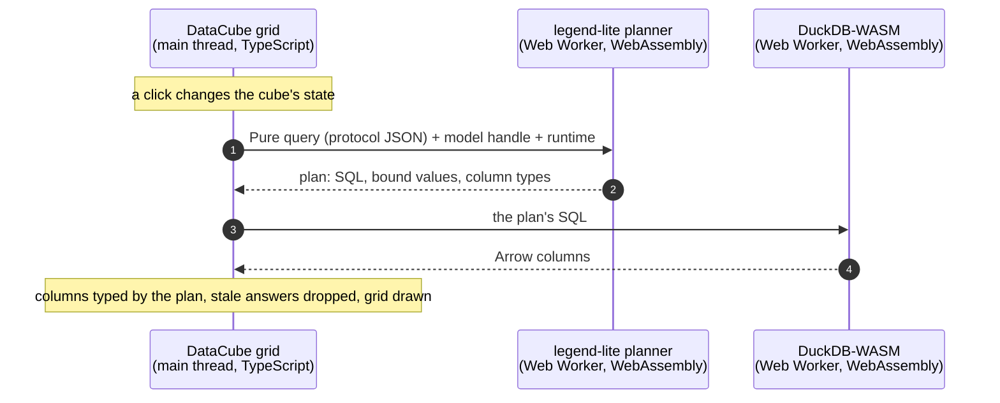
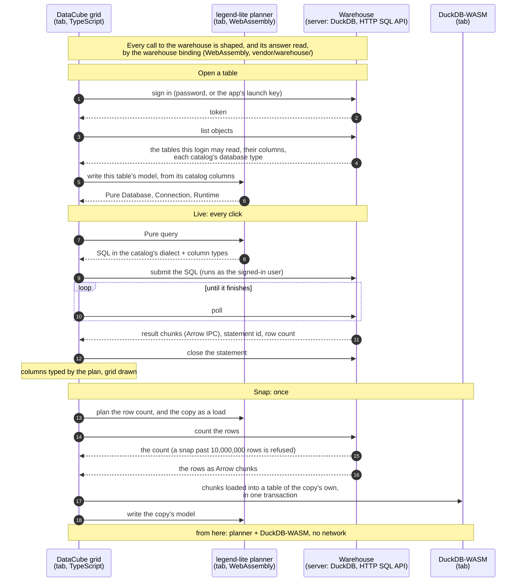
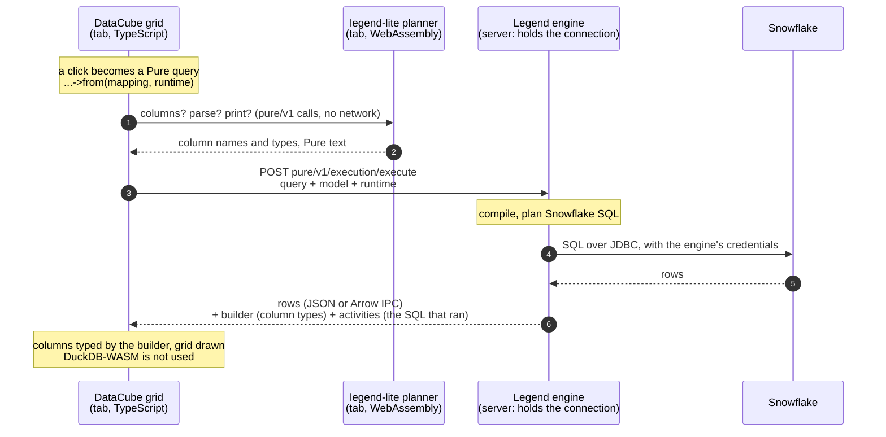
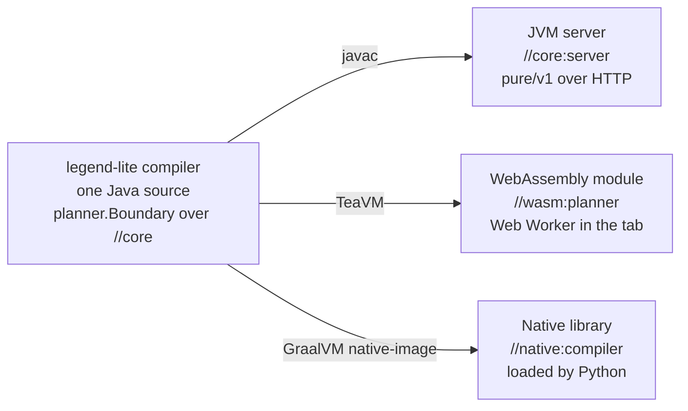

# DataCube: how it runs

DataCube is legend-lite's pivot grid. This document says how a click becomes rows, where that work can
happen, and what WebAssembly has to do with it. It is the reference; the picture version is
[`DATACUBE_ARCHITECTURE.html`](DATACUBE_ARCHITECTURE.html).

Every claim below names the file it was read from. Where a number is quoted, its source and date are
given; the numbers were measured on development machines, so quote the ratios rather than the
milliseconds.

**Contents**

1. [The two jobs](#1-the-two-jobs)
2. [One click, end to end](#2-one-click-end-to-end)
3. [Execution modes](#3-execution-modes)
4. [WebAssembly](#4-webassembly)
5. [Where rows come from](#5-where-rows-come-from)
6. [Configuration](#6-configuration)
7. [Build, run, deploy](#7-build-run-deploy)
8. [Embedding DataCube](#8-embedding-datacube)
9. [What holds this in place](#9-what-holds-this-in-place)
10. [Code map](#10-code-map)

---

## 1. The two jobs

DataCube never computes a value itself. Each interaction (group, filter, pivot, expand, sort) becomes a
**Pure query**, and two jobs follow:

| Job | What it does | Interface |
|---|---|---|
| **Plan** | Compile the Pure query to SQL, and say the type of every result column | `Planner` (`datacube/src/planner-types.ts`) |
| **Run** | Execute that SQL where the rows are, and hand back columns | `QueryEngine` (`engine-client/src/query-engine.ts`) |

Both are the same wherever they happen:

- **One planner.** Planning is always legend-lite's compiler (`Compiler.plan`), or legend-engine answering
  the same `pure/v1` API. The planner in the browser is that compiler built as WebAssembly, not a
  TypeScript rewrite (`datacube/src/lite-planner.ts`, header).
- **One SQL.** Every engine receives the SQL the planner wrote and runs it as written. "Only the place it
  runs differs" (`engine-client/src/engine.ts`, header).
- **Types come from the plan.** A result's columns are typed by the plan (`typedByPlan`), never by the
  database's wire types. A result column the plan does not type is refused, not guessed.

An execution mode is a choice of *where* each job happens. Section 3 lists them.

## 2. One click, end to end

The default arrangement, with everything in the browser tab:



Step by step:

1. **State.** The cube's state (snapshot, configuration, open groups, history) has one owner,
   `CubeStateOwner` (`datacube/src/cube-state.ts`). The controller (`datacube/src/cube.ts`) is stateless
   about the cube: a state in, a view out.
2. **Query.** The controller builds the Pure queries the view needs (a level of the tree, a count, the
   pivot's values) as protocol lambdas (`datacube/src/query.ts`). The query is Pure before it is SQL, in
   every mode.
3. **Plan.** A `QueryRunner` (`datacube/src/runner.ts`) asks the planner. In the tab that is `LitePlanner`
   posting a `plan`/`planJson` request to the planner worker
   (`engine-client/src/legend/planner-worker.ts`), which calls the WebAssembly module's export of the same
   name. The answer is a `Plan`: the SQL, the values it binds, and the columns with their Pure types
   (`engine-client/src/relation-type.ts`).
4. **Run.** The runner hands the plan to the engine. `DuckDbEngine.execute(plan, epoch)` runs the SQL on
   the tab's DuckDB and returns columnar values (`engine-client/src/duckdb.ts`).
5. **Type and draw.** `typedByPlan` attaches the plan's types; the grid formats and draws.
6. **Latest wins.** Queries are issued faster than they finish. Every run carries an epoch, and an answer
   for a superseded epoch resolves as `STALE` and is dropped (`datacube/src/epoch.ts`). Discarding keeps
   the grid correct; cancelling superseded work, where the engine can, keeps it fast.

The runner is chosen once, where the app is constructed, so the hot path holds no branch on mode
(`datacube/src/runner.ts`, header).

**Planning and running are kept apart in the TypeScript too.** `engine-client/` is five Bazel targets
(`:records`, `:run`, `:planner`, `:server`, `:doors`; `engine-client/README.md`): a run module that
imports a planner module fails the build by name, and so does the reverse (`//tools/deps:layers_alone`,
`tools/deps/ts-layers.txt`). A *door* (`engine-client/src/doors/`) asks the planner first and then runs
the answer inside a run frame (`inRun`, `engine-client/src/run-frame.ts`); a planner entry asked inside a
run of its own flow is refused by name (`planning`, `plan-guard.ts`). The grid's own step 4 is such a
run: `inRun('a grid query', ...)` in `runner.ts`.

## 3. Execution modes

### 3.1 Summary

| Mode | Who plans | Who runs the SQL | Where the rows live | What crosses the network | How you get it |
|---|---|---|---|---|---|
| **In the tab** (default) | WebAssembly planner, in the tab | DuckDB-WASM, in the tab | The tab | Nothing | `index.html`, or `?planner=local` |
| **Plan on legend-lite** | legend-lite server (JVM) | DuckDB-WASM, in the tab | The tab | Model and query out, plan back. No rows. | `?planner=remote` |
| **Plan on legend-engine** | legend-engine | DuckDB-WASM, in the tab | The tab | The same | `?planner=engine` |
| **Warehouse, Live** | The page's planner | The warehouse server | The warehouse (DuckDB or Postgres tables) | SQL out, Arrow rows back | *Open a source → Database*; `bazel run //datacube:app` |
| **Warehouse, Snap** | The page's planner | DuckDB-WASM, in the tab | A copy in the tab | One copy of the rows in, then nothing | Click **Live** on a warehouse grid |
| **Python** | Native planner, in the Python process | Python's DuckDB | The Python process (your dataframes) | Pure out, Arrow rows back, on loopback or the notebook's widget channel | `ll.show(df)` |
| **Python, headless** | Native planner | Python's DuckDB | The Python process | Nothing (no browser) | `ll.Page`, `grid.view()` |
| **An engine runs it** | The engine | The engine, on its own store | Wherever the engine's connection points | Pure out, rows back | DataCube embedded in Query on a server plane |

Three rules hold in every mode:

- **The mode is chosen once and shown.** In a tab the planner is `?planner=`, read once as the page loads
  (`chosenPlane`, `datacube/demo/boot.ts`); the status bar names it. Choosing another is a navigation: a
  cube never changes planner while it runs.
- **No fallback.** A planner that does not answer is said on the page (`refusePlanner`) and the page
  stops. It never substitutes another planner. `datacube/test/guardrails.test.ts` holds this; the header
  of `runner.ts` records why (a health-check fallback once hid three real bugs).
- **What a host cannot do, it does not offer.** The app is written against a set of services
  (`datacube/src/app/services.ts`). A host that lacks one simply does not give it, and the app leaves out
  the menu entries that need it.

### 3.2 In the tab (`local`)

Both jobs run inside the page. Nothing is deployed but static files, and a file you open is never
uploaded.

- **Planner:** `LitePlanner` (`datacube/src/lite-planner.ts`) over the module from `//wasm:planner`, on
  its own worker.
- **Engine:** `DuckDbEngine` over DuckDB-WASM, opened by `openDuckDbInTab`
  (`engine-client/src/doors/tab-duckdb.ts`).
- **Runner:** `PlanThenRun` (`localHost(planner, engine)` in `runner.ts`).
- **Startup:** the page preloads `vendor/classes.wasm` with the HTML parse (`datacube/demo/index.html`),
  then starts the planner's warm-up and DuckDB at the same time. They run on separate workers because
  building the planner's boot layer is long synchronous WebAssembly with no yield point; on the main
  thread it froze the page and starved DuckDB's startup (`planner-worker.ts`, header).

Use it for files, samples, static hosting, and anywhere a server is not wanted.

### 3.3 Plan on a server (`remote`, `engine`)

The planning call moves to a server; the data stays in the tab.

- **Planner:** `UpstreamPlanner` (`datacube/src/planner.ts`) over `PureV1Planning`
  (`engine-client/src/pure-v1-planning.ts`), the planning half of the `pure/v1` client, which has no
  execute. It sends the query as
  the protocol tree the cube built and calls `pure/v1/execution/generatePlan` for the SQL and
  `pure/v1/compilation/lambdaRelationType` for a query's columns. The *same requests* go to legend-lite
  and to legend-engine: legend-lite serves those paths exactly
  (`datacube/docs/ENGINE_API_CONTRACT.md`).
- **Engine:** DuckDB-WASM in the tab, unchanged.
- **Addresses:** `legendLite` and `legendEngine` in `config.json`, or `?legendLite=` / `?engine=` for one
  visit. The repository's config names the development servers: legend-lite on `:8080`
  (`bazel run //core:server`) and legend-engine on `:6300`.
- **Health check:** before planning, the page asks `/health` (legend-lite) or `/api/server/v1/info`
  (legend-engine). No answer within 2.5 s is a refusal, with the command to start the server
  (`datacube/demo/planners.ts`).
- **The WebAssembly module is still used.** No server can read a database inside the browser, so the
  tab's own module still sets up the tab's DuckDB session, writes the Pure model for a table you open
  (a file, a remote file, a warehouse table), and writes a saved query's project data
  (`planners.ts`, header). The chosen server then compiles and types that model, and its answer decides
  whether the table opens. A page on these planes therefore still needs `vendor/classes.wasm` and a
  browser with WebAssembly GC.

legend-lite's server listens on loopback and serves pages from loopback origins by default; set
`LEGEND_LITE_ALLOWED_ORIGINS` for another origin (`README.md`, "Run the Server").

Use these planes to check a server's planner against the tab's, or to check parity with legend-engine.

### 3.4 Warehouse: Live and Snap

**What "warehouse" means here.** It is legend-lite's own server component, the `//warehouse` package
("warehouse" is a working name, `docs/WAREHOUSE_W1_DESIGN_2026_09_26.md`): a process that runs DuckDB
behind an HTTP SQL API, with sign-in, and runs every statement as the signed-in user. Its catalogs are
DuckDB or Postgres databases; a Postgres catalog is read through DuckDB's Postgres extension. It is
**not** a Snowflake virtual warehouse, and not a name for any vendor's cloud data warehouse. Snowflake is
not one of the catalogs it attaches; section 3.8 says how a Snowflake connection is reached instead.

The whole flow, from sign-in to a snap:



Three WebAssembly modules take part, each with one job:

| Module | Job in this flow |
|---|---|
| The planner (`classes.wasm`) | Writes the table's Pure model from its catalog columns; plans every query in the catalog's dialect; plans a snap's count and its copy |
| The warehouse binding (`vendor/warehouse/`, `//warehouse:sqlapi_page`) | Names every call to the warehouse (method, path, headers, body) and reads every answer. The TypeScript only performs the `fetch`, keeps the clock, and carries the Arrow bytes. The JVM client and Python's driver use the same binding, so all three speak to the warehouse alike. |
| DuckDB-WASM | Idle while Live. Holds the copy once the grid is snapped. |

**Live: the tab plans, the warehouse runs.**

- **Opening a table.** One call lists every table and view the login may read, with its columns, its
  catalog and that catalog's database type (`listObjects`). The planner writes the table's model from
  those columns; a column that would have to be converted to be declared is left out and named, because
  a warehouse table is read-only (`openedTable`, `datacube/src/app/sources.ts`).
- **Planning.** The planner is the one the page already uses. It plans for the catalog's database type
  (DuckDB or Postgres), so the SQL is in that database's dialect.
- **Running.** `WarehouseEngine` (`engine-client/src/warehouse.ts`, reached through
  `engine-client/src/doors/warehouse.ts`) submits the statement, polls until it finishes, then fetches
  the result a chunk at a time, each chunk an Arrow IPC stream (`arrowChunks`). The statement is closed
  once every chunk is read, and cancelled on the server when a newer interaction has replaced it.
- **Reading.** The chunks are read with the same Arrow library DuckDB-WASM's results come from and
  handed to the same `toRawTable` the local engine uses, then typed by the plan. Cells agree with the
  local plane by construction.
- **Identity.** Queries run as the signed-in user, so the warehouse's own grants decide what is
  readable. The page keeps a token, never the password, and refreshes it at 80% of its life; an expired
  session is its own error (`SessionExpired`), so the cube offers to sign in again.
- **The receipt.** Each result carries what the *server* issued for it: its statement id, its row count,
  and who it ran as. The page can ask the warehouse's history whether that statement is on its record.
- **A limit.** The warehouse runs SQL text alone. A statement that binds values is refused by name
  rather than sent without them (`refuseParams`).

**Snap: freeze the rows into the tab.** Snap-versus-live is two states a person can reason about, rather
than an automatic heuristic (`engine-client/src/snap.ts`, header). Three rules are enforced:

1. A snap always carries its timestamp and row count, so the UI cannot fail to show what is being looked
   at.
2. An operation the embedded engine cannot express is **refused** with a reason. It is never silently
   escalated back to live, which would break the point-in-time guarantee invisibly.
3. A snap captures source rows at drillable grain, never aggregated results, so a drill-through audits
   the same frozen data.

How a snap is taken (`SnapManager.snap`, `engine-client/src/snap.ts`):

1. **Preflight.** The rows are counted where they live: the planner plans the count in the warehouse's
   SQL, and the warehouse runs it. A snap past `MAX_SNAP_ROWS` (10,000,000, a memory ceiling for a tab)
   is refused with "Narrow the filter, or stay live".
2. **A planned load.** The copy is a plan the planner makes (`snapStream`): it names the remote plane and
   the table the rows land in, never a row. The tab's plan runner streams the warehouse's Arrow chunks
   into a table of the copy's own in DuckDB-WASM, in one transaction, kept only when the stream completed
   and the table holds the rows the warehouse counted. These are exactly the rows the server let this
   user read.
3. **The copy's model.** The planner writes a model of what the copy holds. Refused, the copy is dropped.
4. **Rebase.** The grid's queries are repointed at the copy (`rebased`, `runner.ts`), and every later
   query is the in-tab mode's: planner and DuckDB-WASM, no network.

**The single-user app.** `bazel run //datacube:app -- postgresql://reader@host:5432/shop` builds one
folder: the native warehouse server, DuckDB's library, its Postgres extension and the DataCube site. It
listens on `127.0.0.1:8765`, opens the browser on the tables the login may read, and signs the page in
with a launch key in the URL fragment (`#key=…`, never sent to a server). Every query is a read, run in
Postgres through DuckDB's Postgres extension. The user guide is
[`DATACUBE_ON_POSTGRES.md`](DATACUBE_ON_POSTGRES.md).

### 3.5 Python: `ll.show(df)`

DataCube runs in the browser as the UI only. The Python process is its engine
(`python/legend_lite/datacube.py`, `python/legend_lite/engine.py`).

- **The rows are Python's.** The page sends Pure, never SQL. Each grid is one `PlanAndRun`: Python plans
  against the model it holds and runs on its own DuckDB in the same call (`/plan-and-run.json`); the dry
  run is that call's planning half (`/plan.json`). Questions about a query alone (its columns, a parse,
  a print) go to legend-engine's own `pure/v1` routes, which Python answers as every Legend server does
  (`datacube/src/services/python-host.ts`, header).
- **The planner is native.** Python loads legend-lite's compiler as a shared library
  (`//native:compiler`, built by GraalVM native-image, no JVM) and calls it through `ctypes`
  (`native/README.md`, `python/README.md`).
- **The page loads no WebAssembly.** Neither DuckDB-WASM nor the compiler's module is downloaded, and the
  page needs no WebAssembly GC (`datacube/demo/engine.ts`, header; budgeted by
  `datacube/test/bundle-budget.test.ts`).
- **Transport.** A browser tab reaches the engine over HTTP on `127.0.0.1`, with a one-time bearer token
  given in the link's fragment; a notebook's cube uses the notebook's own widget channel, so it works
  where the browser cannot reach the kernel's machine. Results are Arrow IPC.
- **Following Python.** The page asks about once a second whether what it shows has changed
  (`version.json`), so a cell that mutates the frame shows up without a click.
- **One plane.** A Python host plans in process and offers no other plane, and no share links (its
  address is this machine's loopback).

```python
import legend_lite as ll
cube = ll.show(df)          # a browser tab, or under the cell in a notebook
df.loc[0, 'qty'] = 5         # the cube's next query sees it
cube.update(new_df)          # a new frame
cube.close()
```

Install: `bazel build //python:wheel`, then
`pip install 'bazel-bin/python/legend_lite-0.1.0-<platform>.whl[datacube,pandas]'` (`[notebook,pandas]`
for Jupyter, VS Code, Colab and marimo). With nothing installed: `bazel run //python:repl`. Details:
`python/README.md`.

### 3.6 Python, headless

DataCube's own non-screen code (grouping, totals, pivots, export, a chart's rules) runs with no browser,
inside Python, in an embedded V8 (mini-racer, the wheel's `datacube` extra). The headless bundle
(`datacube/src/headless/entry.ts`, `//datacube:headless_bundle`) is given two things by its host: a
planner worker answered by the native library, and a DuckDB connection answered by Python's DuckDB as
Arrow IPC (`datacube/src/headless/host.ts`). Nothing runs as WebAssembly.

This is what makes `grid.view()`, `grid.relation`, `grid.to_pandas()` and `grid.chart(...)` answer exactly
as the screen would: the rules are asked of DataCube's code, never copied into Python.

### 3.7 An engine runs it (`RemoteRun`)

The other shape entirely: Pure in, **rows** out, in one call. The engine executes the query against a
store the browser cannot reach (`pure/v1/execution/execute`), and the SQL the grid shows is the engine's
report of what ran, never an instruction to anyone (`engine-client/src/engine-remote.ts`, header).

- **Runner:** `RemoteRun` over `LegendEngineExecutor`. Its `compile` is the engine's
  `lambdaRelationType`; its `stream` hands the whole result over as one chunk.
- **Where it is used:** DataCube embedded as Legend Query's results grid, on a plane where a legend
  server executes (`query/src/app/cube.ts`).

### 3.8 Worked example: a Snowflake connection

A model whose runtime points at Snowflake is the clearest case of the two jobs coming apart, because the
tab can do one of them and not the other.

**Why the tab cannot run it.** A browser tab cannot open a Snowflake connection: there is no JDBC in a
page, and the credentials belong to a server, not to the person's browser. So the *run* job has to
happen on a server that holds the connection. The *compile* questions (what columns does this query
have, is this calculated column valid, print this query as text) need no database at all, and those stay
in the tab.



Step by step, with the code that does it:

1. **The grid builds the query**, as in every mode. The cube's source is the mapped query, so each
   level, count and pivot is that query with the cube's own steps after it.
2. **The WebAssembly planner answers the compiler's questions in the tab.** Where the app has a planner,
   typing, parsing and printing go to it (`CubePlanner` over `WasmGrammar` in `query/src/app/cube.ts`),
   as `pureV1` requests answered inside the module by the same code that answers them on legend-lite's
   server (`PureV1Api.route`). No network call, so validating a calculated column costs about a warm
   plan. Where the app has no planner, the same questions go to the server's routes instead.
3. **The engine executes.** `RemoteRun` hands the query to `LegendEngineExecutor`
   (`engine-client/src/engine-remote.ts`), which posts it to `pure/v1/execution/execute` with the model
   and the runtime. The page sends Pure and never SQL, and holds no Snowflake credential.
4. **The engine plans Snowflake SQL and runs it** over its own connection.
5. **Rows come back** as the engine's JSON result or, where the engine is declared to serve it, as an
   Arrow IPC stream whose schema metadata carries `legend.builder` (the columns and their types) and
   `legend.activities` (the SQL that ran). The tab types each column from the builder and refuses an
   answer whose stream and builder name different columns. The SQL the grid shows is that report; nothing
   re-runs it.

What each part does in this flow:

| Part | Role with a Snowflake runtime |
|---|---|
| DataCube grid | Unchanged: builds Pure queries, draws rows |
| WebAssembly planner | Parse, print and type queries locally. It can also *plan* the query: the compiler picks its dialect from the connection's database type (`com.legend.database.Databases`) and has a Snowflake dialect (`com.legend.sql.dialect.Snowflake`). That SQL is for showing, not for running in the tab. |
| DuckDB-WASM | **Not used.** The tab's runner refuses a plan made for another database by name: "a plan of a Snowflake database is not run on this DuckDB one" (`checkTarget`, `engine-client/src/plan-runner.ts`). |
| Legend engine | Plans and executes; owns the connection and the credentials |
| Snowflake | Computes every value |

What is true today, and what is not:

- **The executing engine is legend-engine.** legend-lite's own server does not open a declared Snowflake
  connection yet (`com.legend.exec.SnowflakeConnector`: "the platform opens no declared connection to it
  yet"). Its `pure/v1/execution/execute` runs a query on the *project's own database*, made from the
  model's stores and filled with its `Data` rows (`TypedQuery.projectPlan`), which is how a saved query's
  project is browsed without its real store.
- **Where this path is wired.** DataCube embedded as Query's results grid, on a plane whose rows come from
  a legend server (`cubeRows.kind === 'server'`, `query/src/app/context.ts` and `cube.ts`). The standalone DataCube page
  reads files, the warehouse and project data; it has no Snowflake source of its own.
- **No Snap on this path.** A cube whose queries run on a remote engine has no local store to freeze
  into, and says so: "this cube's queries run on a remote engine: there is no local store to freeze a
  snapshot into" (`datacube/src/cube.ts`). The cached pattern upstream's DataCube uses (execute once,
  copy the rows into DuckDB-WASM, then plan for DuckDB and run locally) is where the WebAssembly planner
  would take over both planning and typing, but that source is not built here.

## 4. WebAssembly

### 4.1 What a page loads

Everything is served from the page's own `vendor/` folder (`//datacube:vendor`), never from a CDN: a
cross-origin worker is forbidden, and a deployment behind a firewall has no CDN.

| Module | In `vendor/` | Built from | Does | Loaded |
|---|---|---|---|---|
| **Planner** | `classes.wasm`, `wasm-gc-module-runtime.js` | `//wasm:planner` (TeaVM, WebAssembly GC) | Plans Pure to SQL; types queries; writes a table's model; plans loads, mounts, snaps and session setup | At start on every tab plane |
| **DuckDB** | `duckdb-eh.wasm`, `duckdb-browser-eh.worker.js`, `duckdb-extensions/` | `@duckdb/duckdb-wasm` (npm, pinned) | Runs the SQL; reads CSV, Parquet, Iceberg, remote files | At start on every tab plane |
| **Warehouse binding** | `warehouse/` | `//warehouse:sqlapi_page` | Names every warehouse API call and reads every answer; the same binding the JVM client and Python's driver use | First sign-in |
| **Saved-store rules** | `queries/` | `//query-store:page` | The rules for saved queries and saved pages | First save or open |
| **In-page SDLC** | `sdlc/` | `//sdlc-server:page` | A model home (SDLC and Depot rules) in the page, when `depot.sdlc` is `"page"` | When the model home is first used |

The Python page (section 3.5) loads none of these.

### 4.2 The planner module

**What it is.** `planner.TabExports` (`wasm/src/main/java/planner/`) is TeaVM's entry class. Its
`@JSExport` functions are the module's exports, each a one-line delegation to `planner.Boundary`, which
is plain Java over `//core`: strings in, a string out. TeaVM compiles it ahead of time to a
WebAssembly-GC module in one build action (`wasm/README.md`).

**`plan` is `Compiler.plan` and nothing else.** legend-lite's server answers
`pure/v1/execution/generatePlan` with the same method, so the tab and the server cannot disagree about
dialect, null ordering or aggregates. The dialect comes from the Pure `Connection` the named `Runtime`
resolves to, not from a hard-coded DuckDB.

**Failure is a return value.** Each export answers `"OK\n" + result` or
`"ERR\n" + kind + "\n" + message` (`planner.Folded`), the kind as the server's routes name a refusal
(`PARSER`, `COMPILATION`, else `500`). Refusals are expected answers, so they are compared in the
differentials too, without depending on how TeaVM bridges Java exceptions into JavaScript.

**The worker and its protocol.** One worker (`engine-client/src/legend/planner-worker.ts`,
`//engine-client:planner_worker`) serves every app that plans in a tab: DataCube, Query and Studio. It
answers the planner protocol (`planner-protocol.ts`), whose request kinds are one list:

| Group | Kinds |
|---|---|
| Models | `hold`, `release`, `warm` |
| Planning and typing | `plan`, `planJson`, `planModel`, `executionPlan`, `relationType` |
| legend-engine's API | `pureV1`, `executePlan`, `executeAnswer` |
| Data in, as plans | `tableModel`, `catalogColumnsSql`, `fileLoad`, `remoteMount`, `snapStream`, `snapCopy`, `outputPlan`, `synthesize`, `projectData` |
| The host's database | `sessionSetup`, `hostOperations` |
| Studio's SQL playground | `authored` |

Two things follow from the list being shared:

- **Models are held.** `hold` compiles a model the first time its text is seen and answers a handle;
  later plans name the handle. The compiled models live in the module, so they live as long as the
  worker.
- **Python answers the same protocol.** `python/legend_lite/_planner.py` maps each kind to the native
  library's function of the same name. A kind added to the list fails both hosts at once: the tab's by
  the type checker (`planner-answer.ts`'s switch), Python's by its start-up check.

**Statements a host runs are planned too.** Loading a file, mounting a remote file, copying a snap and
setting up the DuckDB session are all requests to the planner, which answers statements; the tab runs
them as written. The tab's code holds no SQL of its own for these.

**Caching and warm-up.** Planning is pure, so `LitePlanner` caches plans by query text; scrolling
re-issues structurally identical queries. `warmUp()` pays the cold cost (class initialisation and
parsing the Pure prelude) while the page is still loading.

**The prelude is embedded.** A WebAssembly module has no class path, so the Pure prelude is embedded at
build time through TeaVM's `ResourceSupplier` (`PreludeResources`). It costs about 300 KB of module.

### 4.3 DuckDB in the tab

`openDuckDbInTab(vendor, planner)` is the one start of a tab's DuckDB for every app
(`engine-client/src/doors/tab-duckdb.ts`, over `duckdb-tab.ts`). DuckDB's download and instantiate begin
at once, alongside the planner's answers for the setup every connection runs; once both are in, DuckDB is
connected with that setup inside a run frame. The page's floor is the slower of the two starts, never
their sum.

- **One build.** DuckDB's WebAssembly-exception-handling build (`eh`). A browser without that feature is
  refused by name, never handed a build it cannot run.
- **Its own extensions.** ICU, JSON, Parquet and httpfs load from the site's `vendor/duckdb-extensions/`
  (pinned in `MODULE.bazel`), never from `extensions.duckdb.org`.
- **The session the planner's SQL assumes.** Every connection is set up before it is handed out: the
  extension folder, then the planner's `sessionSetup` for the database type (a DuckDB session in UTC).
  Left alone, DuckDB-WASM takes the browser's time zone, and `now()`, `today()` and zoned values would
  answer differently than on a server.
- **Files, not the database.** A host registers a person's file through `TabFiles` (a file registry
  only). The database object itself is not handed out, because its connections would run any text; a
  session's statements are `PlannedSql`, minted where a plan is read.
- **Apps import DuckDB-WASM from `engine-client/src/duckdb-wasm.ts`, never directly**, so every bundle
  carries one copy of Arrow, the one the warehouse reads with too.

### 4.4 One source, three builds



The builds are held to each other by differentials that run on every push:

| Test | Compares |
|---|---|
| `//wasm:differential_test` | The module's answers on `wasm/corpus/` against the JVM's (`//wasm:jvm_answers`), refusals included: 69 queries (63 planned, 6 refused), byte-identical as of 2026-09-23 |
| `//datacube:wasm_differential_test` | DataCube's own serialised cube shapes, module against JVM |
| `//python:bindings_test` | The same corpus through the native library and the Python bindings, against the JVM's answers |
| `//wasm:zone_test` | That the time-zone database is in the module |

The real compile is the other guard. `//wasm:planner` builds in the gate chain, so a Java API the
ahead-of-time class library lacks (`java.security.MessageDigest`, `String.lines()`, `java.util.HexFormat`,
and others) fails the build that introduces it.

### 4.5 What it costs

| | Figure | Source |
|---|---|---|
| Planner module | 4.2 MB raw, 1.46 MB gzip | `wasm/README.md`, 2026-09-20 |
| DuckDB-WASM | about 36 MB | `datacube/demo/README-realdata.md` |
| The whole static site (`dist/`) | about 81 MB before compression | same |
| Warm plan, p50 | 9.6 to 13.9 ms in WebAssembly; 2.4 to 3.1 ms on the JVM | `wasm/README.md` |
| First plan, cold | 557 to 771 ms in WebAssembly; 329 to 481 ms on the JVM | same |
| Planner, WebAssembly against JVM | **4.0x to 4.6x slower**, stable across runs | same |
| DuckDB, WebAssembly against native | **about 2.1x to 2.4x slower** on a 10M-row build and a 500-column pivot | `datacube/bench/README.md` |

What the figures mean in use:

- DataCube plans once per user action, not per keystroke, so a warm plan sits well inside a frame
  budget. The cold cost is the one designed around, which is why `warmUp()` and the preload hint exist.
- Enable gzip or brotli on whatever serves the site; both modules compress heavily.
- For interaction speed the limit is **output cells, not rows**: keep a pivot under roughly 1,000,000
  cells (row groups × pivot columns) to stay near the 300 ms budget (`datacube/bench/README.md`). The
  10M-row snap ceiling is a separate, memory constraint. Both apply.

### 4.6 Browser support and gotchas

- **Tab planes need a current browser.** The planner needs WebAssembly GC; DuckDB needs WebAssembly
  exception handling. Current Chrome, Edge, Firefox and Safari have both.
- **A module that fails to load is not a bad query.** `PlannerUnavailableError` (an operational fault: a
  missing asset, no WebAssembly GC) is deliberately not a `PlanError` (the planner answered, and the
  answer was a refusal). The message names the likelier fix: a 404 says to build the site, anything else
  says the runtime may lack WebAssembly GC.
- **Node 22 needs `--experimental-wasm-exnref`** to load the planner module; without it the module does
  not compile (`Invalid opcode 0x1f`). Browsers that ship WebAssembly GC need no flag.
- **TeaVM's loader wants a URL in a browser and a file path under Node.** `LitePlanner` converts.
- **`ServiceLoader` returns empty in WebAssembly.** Built-in grammars are unaffected, but a grammar
  extension can never load in the WebAssembly build.

## 5. Where rows come from

| Source | How it gets in | Where its queries run |
|---|---|---|
| A CSV or Parquet file you open | Registered with the tab's DuckDB by name; DuckDB sniffs the schema; the planner module writes a Pure `Database`, `Connection` and `Runtime` from the catalog (`datacube/src/infer.ts`, `upload.ts`) | The tab |
| A remote file (`https://`, `s3://`; Parquet, CSV, Iceberg) | Mounted as a **view under the name the model already uses**, so the planner never learns the data is remote (`datacube/src/remote.ts`). DuckDB reads Parquet footers and row groups over HTTP range requests. | The tab |
| Sample data | Generated by the database into a declared table (`synthesize`) | The tab |
| A warehouse table | Listed from the warehouse's catalog; its model written from that catalog | The warehouse (Live) or the tab (Snap) |
| A saved query's project | The project's model, with its `Data` elements loaded into a database of the project's own inside the host's DuckDB (`engine-client/src/project-data.ts`) | The host's DuckDB |
| A dataframe (pandas, polars, Arrow) | Registered with `ll.Frames`, handed to duckdb-python as Arrow | The Python process |

Notes:

- Delta is absent on purpose: the extension is not bundled, and the menu does not offer an action that
  cannot work.
- Credentials are not accepted in the query string. A bucket that needs them is configured by the host
  page (`mountRemote`'s `s3` option).
- Whichever planner the page chose, an opened table's model is written by legend-lite's one writer in
  the tab's module, then compiled and typed by the chosen planner.

## 6. Configuration

**`config.json`**, served beside the page, is deployment data and never compiled in
(`datacube/demo/page-config.ts`). A missing file is an empty configuration, not an error: the local page
needs no server at all.

| Key | Meaning |
|---|---|
| `legendLite` | legend-lite's server, for `?planner=remote` |
| `legendEngine` | legend-engine, for `?planner=engine` |
| `warehouse` | The warehouse the data picker offers first |
| `queryStore` | Where saved queries are kept (an API root answering `/api/pure/v1/query`); empty means this browser's own store |
| `user` | Who the caller is to the browser's own store |
| `projects[]` | The projects a saved query can belong to (`groupId`, `artifactId`, `versionId`, `models`) |
| `depot.sdlc` | Where a project is opened by name: `"page"` (the in-page SDLC) or a server |
| `vendor` | Where the page's WebAssembly is served; default `./vendor/` |

**URL parameters** override the file for one visit:

| Parameter | Effect |
|---|---|
| `?planner=local\|remote\|engine` | Which planner. Absent means `local`. An unknown word is refused. |
| `?legendLite=`, `?engine=`, `?warehouse=`, `?queryStore=` | Override the matching config key |
| `?remote=<url>&format=parquet\|csv\|iceberg` | Read the sample model's table from a remote file (its columns must match the model's) |
| `#key=…&table=schema.name` | The single-user app's launch key: signs in to the warehouse that served the page. A fragment, never sent to a server. |

## 7. Build, run, deploy

```bash
bazel run //datacube:serve                      # the site on loopback, planning and running in the tab
bazel run //datacube:serve -- --data ~/trades.parquet
bazel run //core:server                         # legend-lite on :8080, for ?planner=remote
bazel run //datacube:app -- postgresql://reader@host:5432/shop     # the single-user Postgres app
bazel run //python:repl                         # Python with ll, pd and a sample frame ready
bazel build //datacube:dist                     # the site as a folder for any static host
bazel build //wasm:planner                      # the planner module alone
bazel test  //wasm:all                          # the differentials
```

**Deploying the in-tab mode is copying a folder.** `bazel-bin/datacube/dist/` is self-contained: the
page, the bundles, the models, and the WebAssembly runtimes. S3, GitHub Pages, nginx or a CDN will serve
it. For large remote files, use a host that honours `Range` requests.

DataCube is also served beside Query and Studio from one origin (`//site`), where the apps share the
browser's query store.

## 8. Embedding DataCube

An app that shows a cube imports **one** entry, `datacube/src/embed.ts`: `CubeApp`, `CubeAppOptions`,
`CubeView`, `Planner`, `RemoteRun`, `CubeSnapshot`, `sourceColumns`. It reaches nothing else in
`datacube/src`, so DataCube can change its insides without breaking the embedder. Where queries run is
`engine-client/`'s concern, not DataCube's: the embedder supplies a planner and an engine, or a runner.

Legend Query's results grid is the working example (`query/src/app/cube.ts`): the person's query is the
cube's source, and the rows come from the tab's engine with the tab's planner, or from a legend server's
`execute`.

## 9. What holds this in place

| Guard | Holds |
|---|---|
| `datacube/test/guardrails.test.ts` | Shipped code cannot pick or switch a planner at run time |
| `//tools/deps:layers_alone` | The TypeScript's run side imports no planner, and its planner no run side |
| `datacube/test/bundle-budget.test.ts` | What each page downloads: one copy of Arrow; no DuckDB-WASM or compiler module on the Python page; charts and the query store loaded only when used |
| `//wasm:differential_test`, `//datacube:wasm_differential_test`, `//python:bindings_test` | The three builds of the planner give the same answers |
| `//datacube:live_snap_test` | Live and Snap are one cube on two engines |
| `//datacube:python_engine_test`, `//datacube:headless_test` | The Python engine and the headless host |
| `//datacube:verify_smoke_test`, `//datacube:verify_remote_test`, `//datacube:verify_app_test` | The real page in a real browser: the in-tab plane, a remote file, the Postgres app |
| `//datacube:tour_test` | The screenshot tour ([`DATACUBE_TOUR.md`](DATACUBE_TOUR.md)); manual, in `//gates:heavy` |

A gate result is only about the target that produced it; see [`GATES.md`](GATES.md) before claiming
anything is green.

## 10. Code map

| Path | What |
|---|---|
| `datacube/src/app.ts`, `app/` | The app: the page, its sources, saved pages, model actions |
| `datacube/src/cube.ts`, `cube-state.ts`, `query.ts` | The controller, the state's owner, the queries a view needs |
| `datacube/src/runner.ts` | `QueryRunner`: `PlanAndRun`, `PlanThenRun`, `RemoteRun` |
| `datacube/src/lite-planner.ts`, `planner.ts` | The planner in the tab; the planner on a server |
| `datacube/src/services/browser.ts`, `python-host.ts` | A tab's services; Python's services |
| `datacube/src/headless/` | The headless bundle Python's V8 loads |
| `datacube/src/embed.ts` | The one public entry for an embedding app |
| `datacube/demo/boot.ts`, `planners.ts`, `page-config.ts` | The page's start: plane, planner, configuration |
| `datacube/src/planner-types.ts` | `Planner`: what every planner answers |
| `engine-client/src/query-engine.ts`, `engine.ts` | `QueryEngine`, `typedByPlan`; `setUpSession` |
| `engine-client/src/doors/` | The doors: each asks the planner, then runs the answer (the tab's DuckDB, a file's load, a project's data, the warehouse) |
| `engine-client/src/run-frame.ts`, `plan-guard.ts` | The run frame and the planner's guard: no planning inside a run |
| `engine-client/src/duckdb.ts`, `duckdb-tab.ts` | DuckDB in the tab |
| `engine-client/src/warehouse.ts`, `snap.ts` | The warehouse engine; snaps |
| `engine-client/src/engine-remote.ts`, `pure-v1.ts`, `pure-v1-planning.ts` | Executing on an engine; the `pure/v1` client, and its planning half |
| `engine-client/src/legend/` | The planner worker, its protocol, `BrowserEngine`, `WasmGrammar` |
| `wasm/` | The planner as WebAssembly, and its differentials |
| `native/` | The planner as a native library |
| `python/legend_lite/` | The Python package: compiler bindings, frames, engine, `show` |
| `warehouse/` | The warehouse server and its API binding |

Related documents: [`DATACUBE_ON_POSTGRES.md`](DATACUBE_ON_POSTGRES.md) (user guide),
[`DATACUBE_TOUR.md`](DATACUBE_TOUR.md), `datacube/docs/ENGINE_API_CONTRACT.md`,
`datacube/demo/README-realdata.md`, `wasm/README.md`, `native/README.md`, `python/README.md`,
[`DATACUBE_ONE_APP_DESIGN_2026_10_11.md`](DATACUBE_ONE_APP_DESIGN_2026_10_11.md) (the services design).
