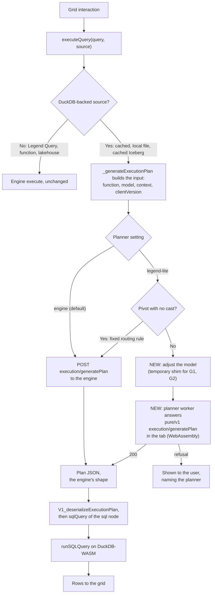
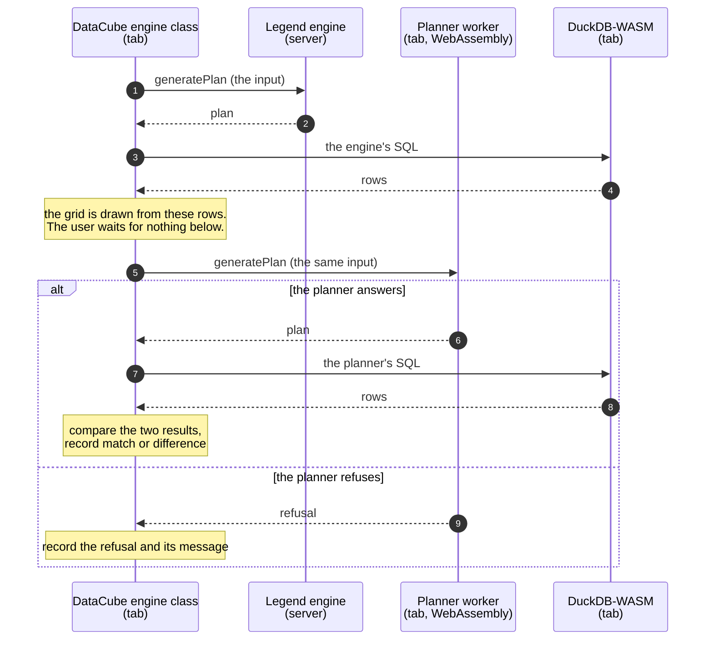

# Integrating legend-lite into legend-studio's apps: a proposal (2026-11-18)

**Status:** proposed, not ratified. Nothing here is built. Section 10 lists the decisions that are the
user's.

**The question (the user, 2026-11-18):** the quickest path to integrate legend-lite into the apps of the
legend-studio repository (Studio, Query, Taxonomy, Marketplace, DataCube), lowest risk first, reusing
legend-lite's WebAssembly where possible. For example: use the wasm planner inside legend-studio's
DataCube to compile a Pure query and get its SQL. How hard is that, and what has to change?

**Evidence:** both repositories were read (legend-lite `main` at `4dfbb5b76`, legend-studio at
`c40833edd`), and nine spikes were run against a freshly built planner module. The scripts and how to run
them are in [`legend-studio-integration-homework/`](legend-studio-integration-homework/README.md).
Section 11 says what was not verified.

---

## 1. The answer in brief

**Start with the standalone DataCube app, on its DuckDB-backed sources only, replacing one engine call
(`generatePlan`) with the wasm planner, behind a setting that is off by default.**

- **It works today, with no legend-lite change, if the request is adjusted on the legend-studio side.**
  The planner answers `generatePlan` in the engine's own plan shape; legend-studio's own deserializer reads
  it and DataCube's own extraction logic finds the SQL (spike 09). Eleven of twelve DataCube-shaped
  queries planned (spike 04), typically in 5 to 10 ms each once the module is warm.
- **It does not work unmodified.** The exact model DataCube sends is refused, for two small reasons
  (section 5, G1 and G2). Either a 20-line shim in legend-studio or two small fixes in legend-lite removes
  both.
- **The change is confined to one legend-studio package**, `legend-application-data-cube`, which only the
  DataCube app depends on. Query, Studio and Marketplace are untouched.
- **Do not start with the "wasm executor".** It refuses the model DataCube sends, needs DuckDB versions
  aligned, and replaces code that already works. Planner first; executor is phase 3.
- **Taxonomy is not a candidate:** it was removed from legend-studio in 2023.

The recommended order, by risk:

| Phase | What | Touches | Users affected |
|---|---|---|---|
| 0 | Package the planner; build a conformance corpus from legend-studio's own DataCube tests | Both repos, no app | None |
| 1 | DataCube app: `generatePlan` for DuckDB-backed sources answered in the tab. Shadow mode first, then opt-in | `legend-application-data-cube` | DataCube, opt-in only |
| 2 | DataCube app: typing and grammar calls in the tab, so a cached cube needs no engine per click | Same package; three new routes in legend-lite | DataCube |
| 3 | The in-tab execute path (the "wasm executor") | Same package; legend-lite | DataCube |
| 4 | Grammar and typing routed to legend-lite for Query and Studio, by configuration | `legend-graph` (every app) | Query, Studio: per deployment |
| 5 | Execution on a legend-lite server | legend-lite server | Later; needs connections, pointers, test execution |

---

## 2. The apps, and how much each depends on the engine

All five talk to the engine through one class, `V1_EngineServerClient`
(`legend-graph/.../v1/engine/V1_EngineServerClient.ts`), which has about 100 endpoint methods.

| App | Needs the engine for | Other servers | Blast radius of a change |
|---|---|---|---|
| **DataCube** (standalone, v0.7) | Grammar, typing, `execute`, `generatePlan`, typeahead, the DataCube store | Depot, lakehouse | **Smallest.** `legend-application-data-cube` is depended on only by its own bootstrap. It builds its own `V1_RemoteEngine` and holds its own client. |
| **Query** (v13.8) | Query store, `execute`, `modelCoverage`, grammar, return types; embeds DataCube and Legend Cube | Depot | Large. Shares `legend-query-builder` and `legend-graph` with Studio. |
| **Studio** (v28.21) | Nearly the whole client: compile, grammar, tests, generation, service registration, database utilities | SDLC, Depot | Largest. |
| **Marketplace** (v0.5) | Little: a few grammar, typing and execute calls through the data-product extension | Many (marketplace, registry, Depot, several lakehouse services) | Small engine surface, but the most other dependencies. |
| **Taxonomy** | Removed in commit `c5e583974` (2023-05-31) | | Not applicable |

Three facts decide the order:

1. **DataCube is the most isolated consumer and already runs SQL in the tab.** For a cached source, a local
   file or a cached Iceberg table, it calls the engine's `generatePlan`, takes the SQL out of the plan, and
   runs it on its own DuckDB-WASM (`LegendDataCubeDataCubeEngine.ts:1058-1143`). The engine is needed there
   only as a compiler. That is exactly the job the wasm planner does.
2. **The shared library is where the risk is.** `legend-graph` is depended on by every app, about 15
   extensions and the VS Code extension. A change to `V1_EngineServerClient` or `V1_RemoteEngine` reaches
   all of them. Phase 1 changes none of it.
3. **There is no plugin hook for the engine.** No request interceptor exists and no plugin can supply an
   engine. The seams that do exist are listed in section 6.

Two things worth knowing that were not asked:

- **Query embeds DataCube** through a different engine class (`QueryBuilderDataCubeEngine`), which has no
  DuckDB caching. Phase 1 does not reach it.
- **Legend Cube** (`legend-cube`, `legend-cube-builder`, v0.0.5) has the cleanest seam in the repository: a
  nine-method `CubeEngine` interface with an injectable implementation. It mostly executes against real
  warehouses, so the planner helps it less than it helps DataCube, but it is the easiest second target.

---

## 3. What legend-lite offers

One compiler, three builds: a JVM server answering legend-engine's `pure/v1` API over HTTP, a WebAssembly
module answering the same routes in a Web Worker, and a native library for Python
(`docs/DATACUBE_ARCHITECTURE.md` section 4.4, added by
[neema2/legend-lite#117](https://github.com/neema2/legend-lite/pull/117)).

The export that matters here is `pureV1OrError(path, rawQuery, body)`: one legend-engine route, answered
in-process by the code the server answers it with (`PureV1Api.route`). Its contract is legend-engine's API,
which makes it the one stable surface of the module.

**The routes legend-studio's DataCube calls, against what legend-lite answers** (through the module and
over HTTP alike, unless noted):

| Route | Answered | Note |
|---|---|---|
| `grammar/grammarToJson/lambda` | Yes | Reads only `returnSourceInformation`; ignores `sourceId` and the offsets |
| `grammar/grammarToJson/model` | Yes | |
| `grammar/jsonToGrammar/lambda` (and `/batch`) | Yes | `PRETTY` and `STANDARD` |
| `compilation/lambdaRelationType` | Yes | Plain type names (section 5, G10) |
| `compilation/lambdaReturnType` | Yes | |
| `execution/generatePlan` | Yes | The engine's plan shape; limits in section 5 |
| `execution/execute` | HTTP only | Runs on the project's own database, not a real connection. Refused through the module: the host runs the SQL |
| `grammar/grammarToJson/valueSpecification` | **No (404)** | Called once per load |
| `grammar/jsonToGrammar/valueSpecification` | **No (404)** | **Called on every grid fetch** (section 7) |
| `compilation/lambdaRelationType/batch` | **No (404)** | |
| `codeCompletion/completeCode` | **No (404)** | Typeahead; errors are swallowed by the editor |
| `compilation/autofix/transformTdsToRelation/lambda` | **No (404)** | Legacy TDS queries only |
| `pure/v1/query`, `pure/v1/query/dataCube` | HTTP, with `--query-store` | A separate module in the tab |

---

## 4. What the spikes showed

All run on 2026-11-18 in Node 25 against `bazel build //wasm:planner` from `main`.

| # | Experiment | Result |
|---|---|---|
| 01 | The engine's routes through the module, on legend-lite's own test model | All answered. The plan is `simple > relationalTdsInstantiation > sql`, with the SQL in `sqlQuery`. Module load 140 ms; first plan 26 ms; warm 8 ms |
| 02 | The in-tab execute halves | Accept the model **only as Pure text that the host already serves**. Inline model JSON is refused |
| 03 | **The exact model DataCube synthesizes** for a DuckDB-backed source | **Refused**: `connection value has no 'postProcessorWithParameter'`. With that field supplied: `an embedded runtime connection is unprobed` |
| 04 | The same model with those two things adjusted | **11 of 12 DataCube-shaped queries plan**, 5 to 20 ms each after the first (195 ms, cold). The table is addressed as `"main"."cache1"`, which is where DataCube puts it |
| 05 | Each aggregate alone; pivot; errors | `last()` fails with an internal error. A pivot with no cast yields SQL that is not runnable as text |
| 06 | The model as Pure text | `generatePlan` works with **no change on either side**. With the model held once, a plan takes **0.6 ms** (median of 20) |
| 07 | Arithmetic on a nullable column (`$x.amount * 2`) | **Compile error** unless written `$x.amount->toOne() * 2` |
| 08 | Each query re-serialized by **legend-studio's own protocol classes** | 8 of 8 plan to the same SQL |
| 09 | legend-lite's plan read by **legend-studio's own deserializer** and DataCube's extraction logic | The SQL is extracted |

What the queries in 04 covered: filter, select, groupBy with a count column, sort, slice, limit, leaf and
group-level extend, `in`, `isEmpty`, `not`, `and`/`or`, case-insensitive contains, `startsWith`,
`endsWith`, column-against-column, date literals, `today()`, `now()`, the variance and standard-deviation
aggregates, `joinStrings`, `uniqueValueOnly`, `average`, `min`, `max`, `first`, pivot with a cast, and the
grid's count-then-sum drilldown pattern.

---

## 5. The gaps found

Each is a specific, reproducible refusal or difference. "Owner" says which repository would change.

| # | Gap | Evidence | Owner | Size |
|---|---|---|---|---|
| **G1** | The model reader requires `postProcessorWithParameter` on a relational connection. legend-studio's serializer omits empty arrays, so it is never sent | Spike 03; `ConnectionReader.java:138` | legend-lite | Small |
| **G2** | `generatePlan` refuses a connection embedded in the runtime. DataCube embeds it and emits no connection element | Spike 03; `PureV1Api.java:1184` | legend-lite | Small |
| **G3** | A pivot with no cast is a two-statement plan in legend-lite (keys first, then the body per key). In the engine-shaped plan its `sqlQuery` is not runnable. DataCube runs exactly this query, with `limit 0`, to discover the pivot's columns | Spike 05; register S110 | Either | Medium |
| **G4** | The `last()` aggregate fails: `an instance literal has no row scope for $x` | Spike 05 | legend-lite | Small to medium |
| **G5** | Arithmetic on a nullable column is a compile error. Whether legend-engine accepts it was not checked. If it does, this is a compile gap that user-written extended columns will hit often | Spike 07; `Typer.java:1122` | legend-lite, after checking the engine | Unknown |
| **G6** | Five routes DataCube calls answer 404 (section 3) | Spike 02 | legend-lite | Small each, except typeahead |
| **G7** | The in-tab execute halves take only a text model the host serves | Spike 02; `PureV1Api.java:1255` | legend-lite | Small |
| **G8** | A model given as a pointer (project coordinates) is refused. DataCube's engine-backed sources send pointers | `ModelInput.java:89-100` | legend-lite | Large: needs Depot |
| **G9** | Errors carry no `sourceInformation`. A parse error's position is in the message text only; a compile error names the element in words. DataCube's editors place markers from `sourceInformation` | Spike 05 | legend-lite | Medium |
| **G10** | Type names are plain (`String`, `Float`, `StrictDate`). The engine answers precise primitives for database columns. DataCube accepts both vocabularies, and treats an unknown name as text | Spike 04; `UpstreamRelationType.java` | None needed for phase 1 | |
| **G11** | DuckDB versions differ: legend-studio pins `@duckdb/duckdb-wasm` 1.31.0; legend-lite is tested on 1.33.1-dev57 (DuckDB 1.5.4). legend-lite's SQL also assumes a UTC session; DataCube sets none | `package.json` of each | Both | See section 8 |
| **G12** | Nothing is published. Every `package.json` is private and no workflow uploads the module. There is no versioning policy for the exports | Section 7 of the investigation | legend-lite | Small |
| **G13** | The module is 9.2 MB (3.4 MB gzip, 2.5 MB brotli), not the 4.2 MB `wasm/README.md` states | Measured 2026-11-18 | Documentation | |

Not gaps, though they looked like ones:

- **The authentication tag.** DataCube's model serializes its test authentication as `h2Default`.
  legend-lite accepted it (spike 04).
- **The plan's shape.** legend-studio needs only a root node with a direct `sql` child carrying
  `sqlQuery`. legend-lite emits that, and its extra fields are ignored.
- **The lambda's JSON.** legend-studio's serializer writes the lambdas differently from legend-lite's
  parser (a different length in every case), and all of them were read (spike 08).

---

## 6. Where a second planner plugs into legend-studio

Four seams exist. They differ in how many apps they reach.

| Seam | Where | Reaches | Verdict |
|---|---|---|---|
| **A. `_generateExecutionPlan`** | One private method of `LegendDataCubeDataCubeEngine` (`:1718-1751`). It builds the input, calls the client, and deserializes | The DataCube app, its three DuckDB branches | **Recommended for phase 1** |
| B. `V1_EngineServerClient.request()` | The one method every endpoint funnels into; already overridden once (`:252-280`) | Every caller of that client instance | Phase 4: the right seam for routing by URL |
| C. A subclass of `V1_RemoteEngine` passed to `graphManager.initialize(config, {engine})` | DataCube and Marketplace already pass an engine this way | The graph-manager path, including DataCube embedded in Query | Phase 4, with B |
| D. `engine.url` in a deployment's `config.json` | No code | One whole deployment | Phase 5. Not usable yet: see below |

**Why not start with D, the zero-code option?** Pointing DataCube's `engine.url` at a legend-lite server
breaks more than it fixes today: the five 404 routes, no pointer models (so no Legend Query or function
sources), no real connections, and no sign-in. It becomes the simplest step once the server is ready,
which is the work the server team is doing. It is the last phase for that reason, not because it is hard.

**Why seam A.** It is one method in one package that only one app loads. The answer it must produce is
already defined (the engine's plan JSON), so the existing deserialization and SQL extraction are reused
unchanged. And because both the engine and the planner answer the same request, a shadow comparison is
nearly free (section 7).

---

## 7. Phase 1 in detail

**Goal:** for a cached source, a local file or a cached Iceberg table, the SQL DataCube runs on its own
DuckDB-WASM comes from the wasm planner instead of a round trip to the engine.

### 7.0 The design flow

Everything outside the two marked boxes exists today and is unchanged.

In `shadow`, the engine's branch above runs exactly as in `engine`, and this happens afterwards, off the
user's path:

The pieces, and where each lives:

| Piece | Where | New? |
|---|---|---|
| The input (`function`, `model`, `context`, `parameterValues`, `clientVersion`) | `_generateExecutionPlan`, `LegendDataCubeDataCubeEngine.ts:1718` | No |
| The setting (`engine`, `shadow`, `legend-lite`) | `LegendDataCubeBaseStore.settings`, beside the two debugger settings there | Yes |
| The routing rule (a pivot with no cast goes to the engine) | In the branch | Yes, temporary (G3) |
| The model shim | Beside the planner client | Yes, temporary (G1, G2) |
| The planner client and its worker | `legend-application-data-cube` | Yes |
| The module (`classes.wasm`, its runtime, `planner-worker.js`) | Static assets, loaded on first use | Yes |
| Plan deserialization and SQL extraction | `LegendDataCubeDataCubeEngine.ts:1071-1078` | No |
| `runSQLQuery` and the conversion to a TDS result | `LegendDataCubeDuckDBEngine.ts` | No |
| The comparison and its record | In the engine class, through DataCube's telemetry hooks | Yes |

### 7.1 Changes in legend-studio

All in `packages/legend-application-data-cube`, plus asset wiring in its deployment package.

1. **A planner client** (new, roughly 150 lines): starts a worker on legend-lite's `planner-worker.js`,
   posts `{kind: 'pureV1', path, query, body}`, and unfolds the answer (`OK\n<status>\n<type>\n<body>`).
   The three files it needs from legend-lite (`planner-worker.ts`, `planner-answer.ts`,
   `planner-protocol.ts`) import nothing outside themselves and one guard file.
2. **Assets:** `classes.wasm`, `wasm-gc-module-runtime.js` and `planner-worker.js` served from the app's
   static folder. The shared webpack config already emits `.wasm` as a resource and the package already
   loads DuckDB's worker with `new URL(..., import.meta.url)`, so no new mechanism is needed. Load the
   module lazily: only when the setting is on and a DuckDB-backed source is opened.
3. **A setting.** DataCube already has persisted settings with a reload flag
   (`LegendDataCubeBaseStore.settings`, two entries today). Add one with three values: `engine` (default),
   `shadow`, `legend-lite`.
4. **The branch.** In `_generateExecutionPlan`, when the setting says so, ask the planner for
   `/api/pure/v1/execution/generatePlan` with the same input object, and hand its body to the same
   `V1_deserializeExecutionPlan`. About ten lines.
5. **A temporary shim** for G1 and G2, until legend-lite fixes them: before sending, move the embedded
   connection into its own `connection` element, point the runtime at it, and add
   `postProcessorWithParameter: []`. A pure JSON transform of about 20 lines, verified by spike 04.
   Alternative with the same effect: send the model as Pure text (spike 06).
6. **A routing rule for the cast-less pivot (G3):** that one query shape stays on the engine until
   legend-lite answers it. It is a fixed rule by query shape, written down and shown, not a fallback on
   failure.
7. **Tests.** DataCube's DuckDB path has no test coverage today and its jest setup mocks DuckDB entirely.
   Add tests for the client's unfolding, the shim, and the branch, with the worker mocked.

### 7.2 Changes in legend-lite

None are required to start. These make the shim and the routing rule unnecessary, in priority order:

1. **G1 and G2:** accept an absent `postProcessorWithParameter`, and plan over a runtime's embedded
   relational connection. Both are the server team's kind of work, and both also block any other
   legend-studio client that sends a synthesized model.
2. **G4:** the `last()` aggregate.
3. **G5:** ask the engine whether `$x.col * 2` compiles on a nullable column, and match it.
4. **G3:** for a DuckDB target, answer the cast-less pivot as one runnable statement in the
   engine-shaped plan.
5. **G12:** publish the three files as a versioned artifact (phase 0).

### 7.3 Shadow mode, which is how the risk is retired

In `shadow`, DataCube asks both planners. The engine's SQL is the one that runs and the one the user sees.
The planner's SQL is then run on the same local DuckDB and the two results compared; a difference or a
refusal is recorded through DataCube's existing telemetry hooks. The data is local, so the second query
costs the user's machine a little and the engine nothing.

This gives a conformance corpus of real queries on real data with no user-visible risk. The setting moves
to `legend-lite` for opt-in users only once shadow differences are understood.

### 7.4 What phase 1 does not do

- **It does not remove the engine round trip per grid fetch.** Every `executeQuery` also awaits
  `getValueSpecificationCode(query)`, which calls `jsonToGrammar/valueSpecification` on the engine
  (`LegendDataCubeDataCubeEngine.ts:1034`), and legend-lite does not answer that route. Phase 1 swaps the
  planner; phase 2 removes the round trips.
- It does not touch engine-backed sources (Legend Query, functions, lakehouse). Those need `execute`
  against real stores and pointer models.
- It does not change DataCube embedded in Query.

### 7.5 How hard, honestly

My estimates, assuming one engineer who knows each codebase:

| Piece | Estimate |
|---|---|
| Phase 0: artifact and a first corpus lane | About a week |
| Phase 1 in legend-studio: client, assets, setting, branch, shim, tests | One to two weeks |
| Phase 1 in legend-lite: G1, G2, G4 | Days each, plus the upstream-fidelity checks legend-lite's rules require |
| Shadow mode running before opt-in | As long as it takes to see real usage; a few weeks |

The engineering is small. What takes time is being sure the SQL means the same thing, which is what phase
0 and shadow mode are for.

---

## 8. Risks

| Risk | Why it matters | Mitigation |
|---|---|---|
| **Same query, different rows** | legend-lite's SQL text differs from the engine's by design; its parity tests compare rows, on its own DuckDB version | Phase 0 corpus; shadow mode comparing rows on the user's own DuckDB |
| **DuckDB version skew (G11)** | legend-lite records real version sensitivities (a `first()` shape on 1.5.0, an ASOF join on 1.4.4). Its SQL is untested on the DuckDB inside `duckdb-wasm` 1.31.0 | Run the corpus on legend-studio's pinned version. Consider aligning the pins; that is a DataCube-wide change and a decision (section 10) |
| **Session time zone** | legend-lite's SQL assumes `SET TimeZone='UTC'`; `today()` and `now()` become `current_date` and `now()`. DataCube's DuckDB keeps the browser's zone | Apply the planner's `sessionSetup` to DataCube's DuckDB, or confirm the engine's SQL has the same dependence |
| **Browser support** | The module needs WebAssembly GC and the newer exception-handling opcodes. A managed browser baseline may lag | Check the supported-browser baseline before phase 1. The setting stays off where unsupported |
| **Compile differences in user-written code (G5, G9)** | Extended columns hold arbitrary Pure. A stricter compiler or a missing error position degrades the editor | Phase 1 only plans queries the engine already typed. The editor's calls move in phase 2, after G5 and G9 |
| **An unstable module API (G12)** | legend-lite's own plan format is at version 51 and moves quickly | Use only `pureV1OrError`, whose contract is the engine's API. Pin the artifact by version |
| **Payload** | 3.4 MB gzipped on top of DuckDB-WASM | Lazy load: only when the setting is on and a DuckDB-backed source opens |
| **A new dependency in a FINOS repository** | legend-lite is not published and not a FINOS project | A decision (section 10) |
| **Silent divergence between planners** | A fallback that hides refusals also hides bugs; legend-lite's own rules forbid it | No silent fallback in `legend-lite` mode: a refusal is shown, with the planner named. Routing by query shape is fixed and written down |

---

## 9. The later phases

**Phase 0: packaging and a corpus (do first).**
- legend-lite publishes `classes.wasm`, its runtime and `planner-worker.js` as one versioned artifact, with
  a typed `pureV1(path, query, body)` client.
- A corpus lane in legend-lite built from legend-studio's own DataCube tests.
  `DataCubeQueryRoundtrip.data-cube-test.ts` is a 2,153-line suite whose cases are DataCube queries as
  Pure text, and CI there runs them against a live engine. Run each through `lambdaRelationType` and `generatePlan` and
  ratchet the count that plan. No test in legend-lite uses legend-studio's requests today.
- A differential against the engine: the same model and query to both, both SQLs run on one DuckDB, rows
  compared.

**Phase 2: typing and grammar in the tab (DataCube).** Once legend-lite answers the two
`valueSpecification` routes and `lambdaRelationType/batch` (G6), move `getValueSpecificationCode`,
`parseValueSpecification`, `_getLambdaRelationType` and the lambda grammar calls for DuckDB-backed sources.
After this a cached cube makes no engine call per interaction. Needs G5 and G9 first, because these calls
serve the editors. These three routes are also used by Query's saved-query load and by Legend Cube, so
they are the highest-leverage additions for the server team.

**Phase 3: the in-tab execute path.** Two different things are called the "wasm executor":
- *The execute halves* (`executeJsonPlan`, then the host runs the SQL, then `executeJsonAnswer`). They
  return the engine's result JSON, written by legend-lite's own writer and typed by the plan. DataCube
  today types results from Arrow type ids and converts every `bigint` to a JavaScript number, which loses
  precision; this would fix that. It needs G7, rows handed back in the exact form legend-lite's decoder
  produces, and DuckDB alignment (G11).
- *legend-lite's DuckDB client* replacing `LegendDataCubeDuckDBEngine`. That also moves ingestion and
  caching, and is a rewrite of code that works. Not recommended.

**Phase 4: Query and Studio, grammar and typing only.** Follow the precedent that already exists: the
client has a separate `queryBaseUrl` for the query store. Add an optional base URL for the grammar and
compilation routes, or route by path inside `request()`, and point it at a legend-lite server per
deployment. legend-lite's parity is strongest exactly here. This changes `legend-graph`, so it reaches
every app; gate it by configuration and start with one canary deployment. Server-side prerequisites
include zlib request bodies (Studio compresses), sign-in, CORS headers beyond `Content-Type`, and the
missing grammar routes.

**Phase 5: execution on a legend-lite server.** Needs real connections (the server opens no declared
Snowflake connection today), pointer models through Depot, test execution, and the rest of the list in the
investigation. This is the server team's roadmap, not an integration step.

**Marketplace** follows Query and Studio: its engine use is small and comes through shared extensions, so
it gains from phase 4 without work of its own.

---

## 10. Decisions that are the user's

1. **The seam and the order.** Seam A in the DataCube app first, as recommended, or something else.
2. **Fallback policy.** Recommended: none in `legend-lite` mode; a refusal is shown. The alternative, fall
   back to the engine on any refusal, is safer for a user in the moment and hides exactly the gaps this
   work is meant to find.
3. **Shim or fix.** Start with the legend-studio shim now, or wait for G1 and G2 in legend-lite.
4. **Distribution.** An npm package, a release artifact, or files copied into legend-studio; and who owns
   the release.
5. **Where the code lands.** legend-studio upstream at FINOS, or a fork. A FINOS repository taking a
   dependency on an unpublished, non-FINOS module is a governance question as much as a technical one.
6. **DuckDB alignment.** Whether to move legend-studio's `duckdb-wasm` pin toward legend-lite's.
7. **Server team priorities.** Whether G1, G2, G4, G5 and the three routes of phase 2 go to the front of
   their queue.

---

## 11. What was not verified

- **No SQL was executed.** No DuckDB was available where the spikes ran. Every "plans" above means the
  planner produced SQL, not that the SQL returned the right rows, on either DuckDB version.
- **Nothing was compared with legend-engine.** No engine was running locally. Whether the engine accepts
  arithmetic on a nullable column (G5), how it names types for these models, and what SQL it writes are
  open.
- **Nothing was run in a browser** or inside legend-studio's build. The module was loaded in Node; the
  webpack and worker wiring in section 7.1 follows from reading the configuration.
- **The lambdas were not DataCube's own.** Spike 08 passed legend-lite's parse of Pure text through
  legend-studio's serializer. DataCube's query builder was not driven.
- **legend-studio's built library was from October**, cross-checked against its sources by reading.
- **Usage per app** is the user's statement. The repository holds no metrics.
- **The estimates in 7.5 are mine**, not measured.
