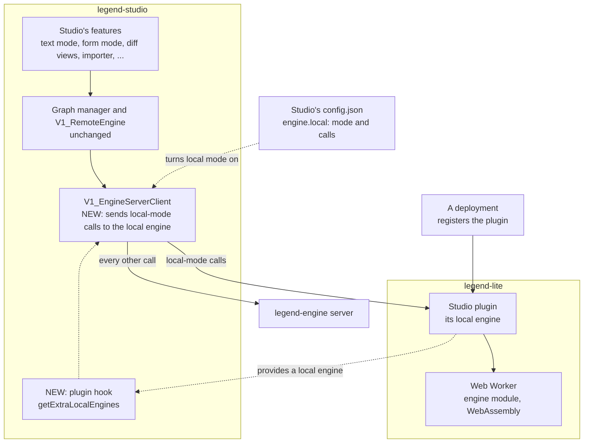
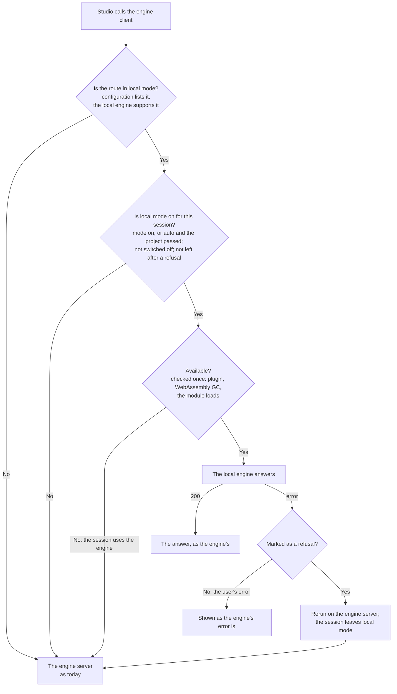
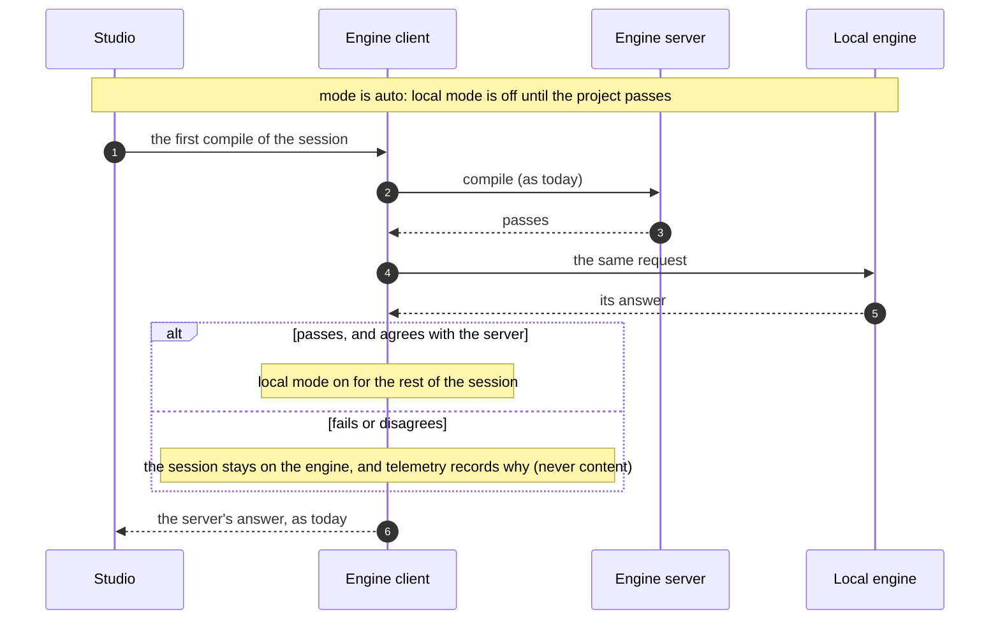
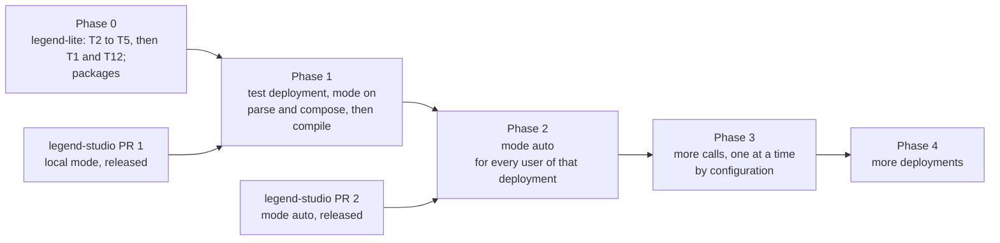

# Legend Studio's local mode: engine calls answered by legend-lite's WebAssembly compiler (a plan, 2026-11-23)

**Status, 2026-11-24:** the author accepted P1 to P7 on 2026-11-23, with option (a) for P2 (2.2). Nothing is merged.
- **PR 1 is open as a draft:** [finos/legend-studio#5962](https://github.com/finos/legend-studio/pull/5962). For now
  it routes the calls the workspace editor makes: form mode, text mode and Text Studio. Its contract and configuration
  differ from 6.2 and 6.3 as those sections note.
- **Phase 0 is under way** on the author's fork of legend-lite. Each pull request is stacked on a sync of `main`:
  - [MauricioUyaguari/legend-lite#13](https://github.com/MauricioUyaguari/legend-lite/pull/13): T2, parse errors carry legend-engine's `sourceInformation`;
  - [MauricioUyaguari/legend-lite#14](https://github.com/MauricioUyaguari/legend-lite/pull/14): T4 and T5, the model JSON against legend-engine 4.152;
  - [MauricioUyaguari/legend-lite#15](https://github.com/MauricioUyaguari/legend-lite/pull/15): #120's engine module in a Web Worker, as its own package (T11);
  - [MauricioUyaguari/legend-lite#16](https://github.com/MauricioUyaguari/legend-lite/pull/16): legend-lite's Studio plugin.

  T3, refusals marked, is next.
- **The probes** in section 4 were run on 2026-11-23. Their scripts and outputs are in
  [`legend-studio-text-mode-homework/`](legend-studio-text-mode-homework/README.md).

**What changed (the author, 2026-11-23).**
- **Legend Studio, not DataCube, is the first product to use legend-lite.** The DataCube proposal
  ([`LEGEND_STUDIO_INTEGRATION_PROPOSAL_2026_11_18.md`](https://github.com/MauricioUyaguari/legend-lite/blob/docs/legend-studio-integration-proposal/docs/LEGEND_STUDIO_INTEGRATION_PROPOSAL_2026_11_18.md),
  first proposed in [neema2/legend-lite#119](https://github.com/neema2/legend-lite/pull/119)) is parked,
  with its hook, [finos/legend-studio#5951](https://github.com/finos/legend-studio/pull/5951), a draft.
- **#120 waits too, with an exception.** This plan needs two parts of
  [neema2/legend-lite#120](https://github.com/neema2/legend-lite/pull/120), and they must land apart from its DataCube
  plugin (T11): the engine module as a package, and the client that answers `pure/v1` routes from a Web Worker.
- **Later the same day, the cut moved from a feature to the engine call.** This plan's first version moved Studio's
  text mode. This version moves a set of engine API calls, wherever Studio makes them:
  - The calls go to a **local engine** that a plugin provides. This plan calls that **local mode**.
  - A Studio config flag turns local mode on for a deployment: "use local if provided".
  - The first set is parse, compose and compile.
  - Phase 2 adds a check that the project compiles before a session uses local mode.
  - The set of calls grows as confidence grows.

**What it builds on:**
- [neema2/legend-lite#113](https://github.com/neema2/legend-lite/pull/113) (open): on its branch, legend-studio's own
  grammar round-trip suite passes 133 of 133, and compile errors carry `sourceInformation`.
- [neema2/legend-lite#100](https://github.com/neema2/legend-lite/pull/100) (a draft): the two protocol routes Studio
  calls when it starts.

## Contents

- [1. The goal](#1-the-goal)
- [2. Decisions and proposals](#2-decisions-and-proposals)
- [3. The three calls in Studio today](#3-the-three-calls-in-studio-today)
- [4. What legend-lite answers today](#4-what-legend-lite-answers-today)
- [5. The gaps](#5-the-gaps)
- [6. The design: local mode](#6-the-design-local-mode)
- [7. The phases](#7-the-phases)
- [8. Risks](#8-risks)
- [9. Questions for legend-studio's maintainers](#9-questions-for-legend-studios-maintainers)
- [10. What was not verified](#10-what-was-not-verified)

## 1. The goal

Studio gets a **local mode**. In local mode, a set of engine API calls is answered in the browser by a local engine
that a plugin provides, instead of by the engine server. legend-lite's engine module, which is WebAssembly run in a
Web Worker, is the first local engine.

The first calls are the three that turn a model into text and back and decide whether it compiles:

| Call | Engine route |
|---|---|
| Parse | `grammar/grammarToJson/model` |
| Compose | `grammar/jsonToGrammar/model` |
| Compile | `compilation/compile` |

Everything else stays on the engine server. The set of local calls grows one call at a time, as each is shown to
answer as the engine does.

A deployment turns local mode on in its configuration and registers the plugin. The first deployment is a test
environment.

## 2. Decisions and proposals

### 2.1 The author's direction, 2026-11-23

The author proposed these and asked for challenges. They stand until ruled; 2.2 refines them. Row 4 is this
plan's reading of "merge the two": the flag and the project check, the author's two first ideas. Row 5 carries over
the answer given for text mode.

| # | Question | Direction |
|---|---|---|
| 1 | What moves | Engine API calls, wherever Studio makes them, not one feature. First parse, compose and compile; more as confidence grows |
| 2 | How a deployment turns it on | A flag in Studio's configuration ("use local if provided"), plus the plugin that provides the local engine |
| 3 | Phase 1 | A test deployment with the flag on and legend-lite loaded, used for a while |
| 4 | Phase 2 | Combine the flag with a check: a session uses local mode once the project passes compile |
| 5 | When the local engine fails during a session | Show its parse and compile errors. When it refuses something it does not support, rerun that call on the engine and stay on the engine for the rest of the session. This departs from the DataCube step's rule that a failure is never retried on the engine |
| 6 | How it reaches a deployment | Through the published packages. A deployment that builds Studio from the published `@finos` packages can use only a hook that is merged and released. legend-lite's packages are not on a public registry, so the deployment publishes them itself and loads legend-lite through a plugin it registers |
| 7 | The DataCube work | Parked. The discussion is reworded around Studio |

### 2.2 Proposed here, and accepted by the author on 2026-11-23

Each of these refines the direction above. The author accepted all seven, choosing (a) for P2: phase 1 starts with
parse and compose, and compile is added by configuration once T1 and T12 land. Sections 5 to 7 give the details.

- **P1. The set of local calls is configuration, not code.** The plugin declares which calls it answers. The
  deployment's configuration lists which of them go local. Studio routes a call locally only if both say so. Adding a
  call is then a configuration change plus legend-lite's support, with no Studio release. Under this, the plugin
  doesn't have to implement a fixed set of three; legend-lite's will implement all three.
- **P2. Compile is not ready, so phase 1's first set is a choice. The author chose (a).**
  - Today legend-lite refuses any compile request that includes the project's dependencies (T1). That is almost
    every real project.
  - Its compile errors also don't return the `sourceId` that form mode uses to place them (T12). A form-mode compile
    error would therefore send the user to text mode every time.
  - Parse and compose need fixes too, but fewer: T2 to T5 (4.7 shows why).
  - So the author chooses:
    - **(a)** start phase 1 with parse and compose once they are ready, and add compile by configuration once T1
      and T12 land;
    - **(b)** wait, and start with all three.
  - (a) starts sooner, but runs the mixed path 4.7 measures: legend-lite parses, the engine compiles.
- **P3. Parse and compose are turned on together.** Text mode composes the model and parses it back. One
  implementation doing both keeps that round trip consistent.
- **P4. Each user can turn local mode off.** A switch in the Dev Tool panel, remembered in the browser, lets a tester
  go back to the engine without a redeployment.
- **P5. Confidence is measured, not assumed.**
  - Every call records whether it ran locally or on the engine, how long it took, and whether it failed or was
    refused.
  - Phase 2's check compares the local engine with the engine server once per session.
  - Optionally, phase 1 compares a sample of calls in the background and logs only the result.
  - Without some comparison, confidence rests on the absence of complaints.
- **P6. "Passes compile" means passes locally and agrees with the engine.** Phase 2's check runs on the first compile
  the engine passes in the session. A project that does not compile yet stays on the engine until it does.
- **P7. "If provided" includes "the browser can run it".** Studio checks before the first local call that a plugin is
  registered, the browser supports WebAssembly GC, which the module needs, and the module loads. Node 20 refuses
  the module (the homework); which browser versions run it is to be checked. If not, the session uses the engine. This is a capability check made once, not a retry after an error.

## 3. The three calls in Studio today

Line numbers are legend-studio at
[`d564dd86d`](https://github.com/finos/legend-studio/tree/d564dd86d3681ae075855b66ca94ecd1584e0368).

### 3.1 Where Studio makes them

All three go through one client class, `V1_EngineServerClient` (`grammarToJSON_model`, `JSONToGrammar_model`,
`compile`). The client is called by these engine methods of `V1_RemoteEngine`:

| Call | `V1_RemoteEngine` methods |
|---|---|
| Parse | `transformCodeToPureModelContextData`, `compileText` (first half), `combineTextAndPMCD` |
| Compose | `transformPureModelContextDataToCode`, `transformProtocolGraphToCode`; also inside `generateFile` (the model as text, sent to the engine's generation route) and `generateModel` (a generated model as text) |
| Compile | `compilePureModelContextData`, `compileText` (second half) |

In Studio and its extensions, nothing else calls the client for these routes. Outside Studio, DataCube and Legend
Cube call the parse route directly, and they are unaffected.

### 3.2 What uses them

What moves to the local engine when each call does, by feature:

| Call | Studio features (graph-manager method) |
|---|---|
| Parse | Text mode: the element index, go to definition, local changes (`pureCodeToEntities`). The model importer, conflict resolution, the schema-set editor, data product ingestion, the GraphQL introspection wizard, the showcase viewer, the query connection workflow. Text mode's compile (`compileText`). Generation from text mode (`buildPMCDWithOptions`) |
| Compose | Entering text mode (`graphToPureCode`, `entitiesToPureCode`). Text Studio's load. The diff views and conflict editor, each element's grammar view, the service editor (`elementsToPureCode`), the database builder wizards, mapping test migration, the data product editor and access points, the data space home tab, dev metadata and the Dev Tool panel. File generation's input and model generation's output |
| Compile | Form mode's compile, F9 (`compileGraph`). Text mode's compile, F9 and leaving it (`compileText`). Text Studio's load. The schema-set editor. The project dependency editor, the data space query promotion reviewer and the query productionizer (`compileEntities`) |

Studio's text mode uses exactly these three calls and no others. When Studio's round-trip suite ran through the
module (4.1), the shim served only these three, plus the two start-up protocol routes, which stay on the engine.

### 3.3 What Studio does with the answers

- **Parse output becomes Studio's graph and the workspace's changes.** In text mode, Studio rebuilds its graph from
  the parse output (`updateGraphAndApplication`, line 415 of `GraphEditGrammarModeState.ts`). It computes local
  changes from that output too.
  - Each changed element is pushed to SDLC with the parsed JSON as its content (`ChangeDetectionState.ts`, lines 166
    to 226). **In local mode, legend-lite's JSON is what gets committed for every element a user changes in text
    mode.**
  - A difference in that JSON also shows as a change nobody made.
- **Errors are placed by their `sourceInformation`.**
  - Text mode puts the cursor at the error's position.
  - Form mode compiles with `keepSourceInformation: true`. Each lambda carries a `sourceId` built from its element and
    field, such as `model::A@derivedProperty@upper@<uuid>`. Form mode finds the editor for an error from the `sourceId`
    the error returns (`GraphEditFormModeState.ts`, around line 512). When it can't, it switches the user to text
    mode.
- **A compile request holds the dependencies.** `compileText` (line 2172 of `V1_PureGraphManager.ts`) appends:
  - the dependencies' entities, as they came from Depot (`V1_serializePureModelContext`);
  - the generated elements;
  - the parsed project, whose section index lists only the project's own elements (`mergeObjects`).

  Form mode's `compileGraph` sends the whole graph, dependencies included.

## 4. What legend-lite answers today

**Setup, 2026-11-23:**
- **legend-lite:** `0be02799d`, which is neema2/legend-lite#113's branch merged with `main` at `2942e9838` (the
  fork's branch `claude/sync-neema-main-2026-11-23`).
- **Module:** `//wasm:engine_planner_dir`, a 9.3 MB `classes.wasm`, run in Node 25.
- **legend-engine:** a local build reporting version 4.152.1-SNAPSHOT.
- **Cases:** legend-studio's 135 grammar round-trip cases (`legend-manual-tests`).

### 4.1 Studio's own round-trip suite, against each server

The module answered behind a 70-line local HTTP shim (`shim.mjs`). Each case runs twice, with and without Studio's
extensions.

| Server | Passed | Failed |
|---|---|---|
| legend-engine (local) | 266 of 270 | 4: the two `###GraphQL` cases, which this engine build can't parse either |
| legend-lite (module) | 265 of 270 | 5: the same four, plus `DSL_DataQuality-relation-comparison-advanced` with extensions. The engine writes `additionalColumnsToPersist: []`, Studio's extension writes it too, and legend-lite leaves the field out |

**What this checks, and what it doesn't.** In each case:
- Studio reads one server's JSON, builds its graph, serializes it again and compares;
- the same server composes the model and compiles Studio's serialized JSON.

So it shows that Studio accepts legend-lite's output and that legend-lite compiles Studio's own JSON. It does not
compare legend-lite with the engine. 4.2 does that.

### 4.2 legend-lite against the engine, on the same text

This calls `grammarToJson/model?returnSourceInformation=true`, as text mode does, on the 133 cases both servers
parse.

| Result | Cases |
|---|---|
| Identical JSON, every `sourceInformation` included | 124 |
| Differ only in `sourceInformation` (the end positions of multi-line string literals) | 1 |
| Differ in content | 8 |

**Each element's own position, which Studio indexes:** 929 of 929 identical.

The eight content differences:

| Difference | Engine | legend-lite | Cases |
|---|---|---|---|
| A function test's test data | `_type` and `elementPointer` | `packageableElementPointer` | 2 |
| A negative literal in a function test | the integer `-3` | `minus(3)` | 1 |
| `DataQualityRelationComparison` | writes `additionalColumnsToPersist: []` | leaves it out | 1 |
| A relational connection's `timeZone` | keeps the quotes, `'America/New_York'` | drops them | 4 |

**The cause is not established.** legend-lite's parity tests compare it with legend-engine 4.145.0, its pin. The
engine here reports a later version. Two things count against simply calling these newer-engine changes:
- #113 dates the DataQuality field to 4.148.0;
- this engine build can't parse `###GraphQL`, which Studio's own cases use.

**Unmeasured:** whether any of these differences changes the hashes Studio computes for local changes.

### 4.3 Errors

| Input | Engine | legend-lite |
|---|---|---|
| A parse error (missing `;`) | 400 `PARSER`, `sourceInformation` at the token | 400 `PARSER`, **no `sourceInformation`**. The position is only in the message, `[4:1] expected SEMI_COLON ...` |
| An unknown property type | 400 `COMPILATION`, `sourceInformation` at the type (line 3, columns 9 to 13) | 400 `COMPILATION`, `sourceInformation` covering the whole class (lines 1 to 4; register row S400) |
| An unknown property in a derived property | at the property access | the whole class |
| A function body of the wrong type | at the body | the whole function |
| A Pure class mapping with no `~src` | 200: compiles | 400 `COMPILATION`. legend-lite refuses it by ruling (register row S21), and nothing in the answer says it is a refusal |

The wording differs in every case. legend-lite's messages also start with `[line:col]`.

### 4.4 A compile with dependencies, as Studio sends it

A one-class "dependency", given as JSON, was appended to a project parsed by legend-lite with its section index, as
Studio's merge does it.

- **Engine:** 200.
- **legend-lite:** 400, `dep::Person: the model's section index lists no section for it`.

**This blocks local compile for any project with dependencies or generated elements** (T1).

### 4.5 Form mode's compile errors

A derived property's lambda was stamped with Studio's `sourceId`, `model::A@derivedProperty@upper@u1`, with an error
in it, as form mode sends it (`sourceid.mjs`).

| | Error position | `sourceId` |
|---|---|---|
| Engine | the expression (line 4, columns 18 to 20) | `model::A@derivedProperty@upper@u1` |
| legend-lite | the whole class (lines 1 to 5) | empty |

With legend-lite's answer, form mode can't find the editor, so it would switch the user to text mode on every compile
error (T12).

### 4.6 Timings

Milliseconds, the mean of two runs; for the smallest model, the range. Caveats:
- Both sides were already warm.
- legend-lite ran in Node 25, not a browser.
- The engine was local, reached over loopback, so there was no network and no upload.
- No dependencies were in the compile, because of 4.4.

| Model | Parse: lite / engine | Compose: lite / engine | Compile: lite / engine |
|---|---|---|---|
| Largest Studio case (10 elements) | 1 / 8 | 1 to 6 / 1 to 2 | 11 to 19 / 9 to 12 |
| Synthetic: 500 classes, 100 functions | 28 / 89 | 74 / 21 | 168 / 50 |
| Synthetic: 2,000 classes, 400 functions | 128 / 383 | 270 / 58 | 634 / 153 |

Against a warm local engine, legend-lite parses about 3 times faster, composes about 4.5 times slower and compiles
about 4 times slower. A deployed engine adds the network, plus an upload of the whole project and its dependencies on
every compile. The module adds a one-time download of 9.3 MB.

### 4.7 Each one's JSON in the other

Local mode mixes the two whenever only some calls are local, and whenever a local call reads JSON the engine wrote, as
stored entities are (`mixed.mjs`):

| Path | Where Studio takes it | Result |
|---|---|---|
| legend-lite parses, the engine compiles the JSON | Text mode's compile, with parse local and compile on the server | 132 of 133 compile. On `CORE-function-test-variants`, the engine fails with a 500 (`ClassCastException`) on legend-lite's `minus(3)` (4.2); on its own JSON it compiles |
| The engine's JSON, composed by legend-lite, `PRETTY` and `STANDARD` alike | Text Studio's load and the diff views, which compose stored entities | 126 of 133 identical to the engine's text. The three function-test cases fail with a 500: legend-lite can't read the engine's newer test-data shape (`_type` and `elementPointer`). The four connection cases write the engine's quoted `timeZone` as `'\'UTC\''` |

So even parse and compose need the JSON aligned first. The engine must read whatever legend-lite writes (T4). And
legend-lite must read, and compose like the engine, whatever the deployment's engine wrote into the project (T5).

## 5. The gaps

Each gap is in legend-lite unless the table says otherwise. "Blocks" names the call that can't go local until the gap
is closed.

| # | Gap | Evidence | Blocks |
|---|---|---|---|
| T1 | Compile a request whose section index doesn't list every element (dependencies, generated elements) | 4.4 | Compile |
| T12 | Compile errors return the failing expression's `sourceInformation` from the request: its `sourceId` and position, as the engine does. This also covers S400's element-level positions | 4.5 | Compile (form mode) |
| T2 | Parse errors carry `sourceInformation` in the engine's shape | 4.3 | Parse (the cursor on a syntax error) |
| T3 | Mark refusals in the error answer: "not supported", and the ledgered cases where legend-lite rejects what the engine accepts (S21). Until then, ruling 5's rerun can't fire, and every local failure is shown as it is | 4.3 | All three (ruling 5) |
| T4 | Write the engine's JSON. The engine must read whatever legend-lite writes, because it is committed and the server compiles it; today `minus(3)` crashes the engine's compile. And measure whether any remaining difference changes Studio's hashes | 4.2, 4.7, 3.3 | Parse |
| T5 | Target the engine version the deployment runs: read every shape it writes, and compose it as it does. Today legend-lite can't read its function-test data, and it re-quotes its `timeZone`. Rerun 4.1, 4.2 and 4.7 against it, then align or ledger every difference | 4.2, 4.7 | Parse, compose |
| T6 | The deployment's real projects, dependency closures and sections, measured inside the deployment (a script; only counts leave) | none yet | All three, for that deployment |
| T8 | Error wording: legend-engine's words, or a ledgered difference | 4.3 | None (quality) |
| T9 | `###GraphQL`, and any other section the deployment's projects use. A missing section is a refusal once T3 lands | 4.1 | None (refused, then rerun) |
| T10 | Speed: hold the dependencies in the worker across compiles, so each compile sends only the project | 4.6 | Compile, if T6's timings need it |
| T11 | Land #113 and #100 on legend-lite's `main`. From #120, land the engine module's package and the worker client apart from its DataCube plugin | | Phase 1 |

Every difference legend-lite keeps becomes a row of `docs/SEMANTICS_REGISTER.md`, posted to the user before it lands,
as for #113.

## 6. The design: local mode

Everything in this section is **proposed**. The hook, the configuration and the routing are not built.

### 6.1 Where the code lives



The cut is inside the engine client, below everything that builds requests and reads answers:
- `V1_RemoteEngine`'s request building, its parser and compilation error mapping, its source index and its
  warnings all stay as they are;
- so does everything above them: the graph manager, the graph builder, change detection and every feature.

A local engine receives exactly what the engine server would receive, and must answer exactly what it would answer.

### 6.2 The contract (proposed; the names are to be settled in review)

```ts
// a call is named by its engine route, e.g. 'grammar/grammarToJson/model'
type EngineRoute = string;

interface LegendStudioLocalEngine {
  key: string; // names it in the configuration and telemetry
  label: string; // shown to the user: messages, the Dev Tool panel
  supportedRoutes: EngineRoute[]; // the calls it answers
  /** answers one call as legend-engine's route would: the same request, the same status and JSON back */
  answer(
    route: EngineRoute,
    request: { query: Record<string, string>; body: string },
  ): Promise<{ status: number; body: string }>;
  isAvailable?(): Promise<boolean>; // checked once, before the first local call (P7)
  isRefusal?(response: { status: number; body: string }): boolean; // "not supported here" (ruling 5, T3)
  dispose?(): void;
}

class LegendStudioApplicationPlugin {
  getExtraLocalEngines?(): LegendStudioLocalEngine[];
}
```

- **The answer is the route's own HTTP answer.** A failure is the engine's status and error JSON, so the client turns
  it into the same `NetworkClientError` it builds for the server. Studio's existing handling then applies unchanged.
- **legend-lite implements `answer` in one line**, over its module's `pureV1OrError(path, query, body)`. Its worker
  and client already exist in #120's DataCube plugin.
- **The set can grow.** The contract has no fixed list of calls, so a new call needs no change to it (P1).

**As built in PR 1** ([finos/legend-studio#5962](https://github.com/finos/legend-studio/pull/5962), 2026-11-24), with
four differences:
- **No `dispose()`.** Engines come from the application's plugins, every editor shares them, and Studio never
  disposes one.
- **A route is named below `pure/v1/`**, e.g. `grammar/grammarToJson/model`, with no leading slash and no query.
- **A thrown error is shown to the user and not rerun,** and the session stays local. A refusal must be an answer
  that `isRefusal` recognizes (6.5).
- **The configuration has an optional `engine.local.engine`:** the key of the engine to use when plugins provide
  more than one (6.3).

### 6.3 The configuration, and a switch for each user

Studio's `config.json` already has an `engine` block. Local mode would sit in it:

```json
"engine": {
  "url": "https://engine.example.org/api",
  "local": {
    "mode": "on",
    "routes": ["grammar/grammarToJson/model", "grammar/jsonToGrammar/model"]
  }
}
```

| `mode` | Meaning | Phase |
|---|---|---|
| `off`, or no `local` block | Today's behaviour | |
| `on` | "Use local if provided": the listed calls go to the local engine whenever a plugin provides one and the browser can run it | 1 |
| `auto` | As `on`, but only after the session's project passes the check (6.6) | 2 |

- **`routes`** lists the calls that go local. A call goes local only if it is listed here and in the local engine's
  `supportedRoutes`. Adding compile in phase 1 is adding its route here (P2).
- **The configuration is read when the app loads.** Changing it needs no new build.
- **The Dev Tool panel** gets "Local engine: on/off for this browser", beside the engine client's switches. It can
  only turn local mode off, never on where the deployment has it off (P4).
- **A label** in text mode's header and on the compile notifications says who answered.

**As built in PR 1:** `mode` is `off` or `on`; any other value, `auto` included, means `off` until PR 2. The switch
reads "Local engine: off for this browser". The label saying who answered is not built.

### 6.4 How a call is routed



### 6.5 Failures and refusals (ruling 5)

- **An error in the user's model** from the local engine is shown as Studio shows the engine's: a notification, the
  problems panel, and the cursor or the form editor at its position. This needs T2 and T12 to place it as the engine
  does.
- **A refusal** reruns the same call on the engine server. The session then leaves local mode for every call, so a
  session uses one implementation at a time. The user sees a notice once.
- **The local engine decides what a refusal is** (`isRefusal`). legend-lite's plugin recognizes legend-lite's marker
  (T3). Until T3 lands, legend-lite marks nothing, and every local failure is shown as it is.
- **As built (2026-11-24):** a refusal is always an answer, never a thrown error (6.2). legend-lite marks three
  kinds: `UNSUPPORTED` and `RULED`, which its module writes (T3), and `UNAVAILABLE`, which its plugin writes when its
  worker or module failed and could not answer at all ([MauricioUyaguari/legend-lite#16](https://github.com/MauricioUyaguari/legend-lite/pull/16)).

### 6.6 Phase 2: the project check



- **When it runs:** on the first compile the server passes in the session.
  - In Text Studio that is the project's load.
  - In the full editor it is the first compile, in form mode or text mode.
  - The check adds no server call, because the server compiles at that moment anyway.
- **What "agrees" means:**
  - both compile without error;
  - for a text compile, the local parse JSON equals the server's;
  - optionally, the local engine also composes the parsed model, and its text is compared with the server's.
- **A project that doesn't compile yet** stays on the engine until a compile passes.
- **An alternative:** check at project load in the full editor too. That costs one more compile on each side, in
  every session, including the many that never compile. Not recommended.

### 6.7 Telemetry

Studio already logs compiles, text mode's sessions and their timings. Each call gains:
- whether it ran locally or on the engine;
- the local engine's key;
- how long it took;
- whether it failed or was refused, and the refusal's kind.

Phase 2 adds the check's result: agreed, or which part disagreed, with element counts.

None of it carries text, JSON or element paths. An optional sampled comparison in phase 1 (P5) would log only
"same" or "different".

## 7. The phases



| Phase | Work | Exit |
|---|---|---|
| **0. legend-lite ready** | **For parse and compose:** T2, T3, T4 and T5, against the deployment's engine version. T11. Lanes in legend-lite: Studio's round trip through the module, each one's JSON in the other (4.7), the error shapes. The packages: the module, the worker client, the Studio plugin and its guide, published by the deployment. **For compile:** T1 and T12, and lanes for the dependency request and form mode's `sourceId` | **Parse and compose ready:** parse errors place the cursor, refusals are marked, and no JSON difference is left that the engine can't read or that moves a hash. **Compile ready:** a project with dependencies compiles, and form-mode errors carry the request's `sourceId` |
| **PR 1 (legend-studio)** | The hook and contract (6.2), the configuration (6.3), the routing in the engine client (6.4), the Dev Tool switch, the refusal handling (6.5), the telemetry (6.7), a guide to writing a local engine plugin, tests. Released | Released in `@finos/legend-graph` and `@finos/legend-application-studio`. legend-lite's plugin builds against the release |
| **1. A test deployment, mode `on`** | Upgrade to the release. Register the plugin and serve the module. Set `mode: on`: with parse and compose, then compile's route once compile is ready (P2 (a)), or all three once all are ready (P2 (b)). Testers use Studio as usual | Over an agreed period: entering and leaving text mode without edits leaves no local change; no committed JSON the engine rejects; no verdict the pipeline contradicts; refusals counted by kind; times known on real projects |
| **PR 2 (legend-studio)** | `mode: auto` and the project check (6.6). It can start during phase 1 | Released |
| **2. That deployment, mode `auto`** | Every user of the deployment. Local mode where the project passes | The agreement rate on real projects is known and high, and no wrong verdict is reported |
| **3. More calls** | One call at a time, each first proven in a legend-lite lane, then added to `routes` | Each call's own measurements in that deployment |
| **4. More deployments** | Others opt in through their own configuration | Each deployment's own phases 1 and 2 |

**Phase 3's candidate calls,** in a suggested order:

| Calls | Used by | legend-lite today |
|---|---|---|
| `grammar/grammarToJson/lambda`, `grammar/jsonToGrammar/lambda` (and `/batch`) | Every form editor with a lambda: shown as text on load, parsed on edit | Answers them (the DataCube proposal, section 3). Not yet measured against Studio's editors |
| `compilation/lambdaReturnType`, `compilation/lambdaRelationType` | Editors that type a lambda (mapping, query builder) | Answers them. Plain type names where the engine gives database ones (the DataCube proposal's G10) |
| `grammar/grammarToJson/valueSpecification`, `grammar/jsonToGrammar/valueSpecification` (and `/batch`) | The query builder | Not yet (the DataCube proposal's G6) |
| `grammar/grammarToJson/relationalOperationElement`, its compose route | The database editor | Not measured |
| `protocol/pure/getClassifierPathMap`, `protocol/pure/getSubtypeInfo` | Studio's start-up | #100 |
| `execution/generatePlan` | Showing a query's plan | Answers it, with the DataCube proposal's limits |

Execution, tests, generation and service registration stay on the engine server.

**Why two pull requests.** PR 1 is small enough to review and release quickly, and phase 1 only needs PR 1. PR 2's
design benefits from what phase 1 shows. Each needs a release, but PR 2's release can happen while phase 1 runs.

## 8. Risks

| Risk | Why it matters | Mitigation |
|---|---|---|
| **legend-lite accepts what the engine rejects** | The user commits it, and the project's build, which compiles on the engine, fails. Telemetry can't see this | legend-lite's parser mutation tests and engine-dialect strictness; phase 2's agreement check; optional sampled comparison (P5); testers report pipeline failures in phase 1 |
| **legend-lite's JSON is committed** | In text mode, every changed element is pushed with the parser's JSON (3.3) | T4 and T5 before phase 1: no difference the engine can't read, and none that moves a hash |
| **Form mode's errors** | Without T12, every form-mode compile error sends the user to text mode | Compile is not local until T12 lands (P2) |
| **Engine version drift** | legend-lite matches one engine version, and deployments upgrade | T5: pin legend-lite's parity to the deployment's version. Rerun 4.1 and 4.2 on every upgrade |
| **Large projects** | Composing and compiling are about 4 times slower than a warm engine, and dependencies are recompiled on every compile | T6 measures real projects, T10 holds the dependencies, and `routes` can leave compile on the engine |
| **The release wait** | Phase 1 can't start before PR 1 is released | PR 1 kept small; phase 0 runs meanwhile |
| **A refusal anywhere ends local mode** | Routing by call includes the importer, the diff views and the generation steps, and a refusal in any of them moves the session to the engine | Counted in phase 1; refusals become legend-lite fixes |
| **A local call that never answers** | Neither Studio's engine client nor legend-lite's worker transport times out a call, so a stalled module download or a module that never answers leaves the user waiting (found 2026-11-24) | Not addressed yet. A timeout in legend-lite's plugin, answered as `UNAVAILABLE`, would rerun the call on the engine |
| **Download and memory** | 9.3 MB on first use, and a second copy of the model in the worker | Fetched only on first use, then cached; measured in phase 1 |

## 9. Questions for legend-studio's maintainers

1. Is a local-engine hook acceptable in `legend-application-studio`, with the routing in `legend-graph`'s engine
   client? It is generic, and nothing changes without both a plugin and the configuration.
2. Should the calls that may go local be any route the configuration lists, or a list Studio fixes in code? The
   first lets a deployment add a call without a Studio release. The second keeps each new call behind a review.
3. Should the contract be one `answer(route, request)` method, or one typed method per call?
4. Is `engine.local` in `config.json`, with `mode` and `routes`, the right place?
5. Are telemetry events with counts and timings, and never model content, acceptable?

## 10. What was not verified

- **A browser.** Every probe ran in Node 25 (V8, as in Chrome). No browser, worker or bundler was used. The DataCube
  step ran an earlier build of the module in a worker in Chrome on 2026-11-23.
- **Real projects.** Only Studio's 135 cases and two synthetic models were used. Real projects, their dependencies
  and their sections are T6.
- **The deployment's engine version.** The engine used reports 4.152.1-SNAPSHOT. Its differences from legend-lite
  (4.2) are not explained.
- **Studio's hashes** for 4.2's eight differing cases (T4).
- **The other callers.** Only text mode and form mode's error placement were probed. The importer, the diff views,
  generation and the other callers in 3.2 were read in the code, not run. So was the compile of Studio's unknown
  elements, the raw JSON of extensions Studio has no plugin for.
- **Warnings.** Whether legend-lite returns the engine's compile warnings (deprecations, for example) was not
  checked.
- **Any Studio code.** The hook, the configuration and the routing are a design, not code.
- **Where the cut sits.** Studio's engine client compresses request bodies (`enableCompression`). Reading the code,
  this happens in legend-shared's `NetworkClient`, after the server client's `request()`. So a cut in `request()`
  sees the uncompressed body. This was read, not run.
- **Timings with dependencies** (4.4 stopped them), in a browser, or against a deployed engine.
