# Timeseries queries in Legend: a guide for quants

2026-10-30 · draft for review. The rules in full are the specification, [TIMESERIES_LANGUAGE_2026_10_29.md](TIMESERIES_LANGUAGE_2026_10_29.md).

## What this is, and what we want from you

We propose one formula language for timeseries in Legend: written like SQL, computed entirely by the database, and the same in the DataCube timeseries tile, in Python and in Pure. It is a design, not yet built, and we want quants to check it before we build it.

Today the tile reads gs-quant-style formulas such as `volatility(close[SPX], 63)`, but only the tile understands them. The proposal keeps those formulas almost as they are and gives them a home in the platform, so a formula means the same thing in a chart, a notebook, a saved query or a service.

What we would most like from you:

- **Definitions.** Is each function computed the way you would compute it (returns, windows, annualization, regressions)?
- **Defaults and units.** Every figure is a ratio (a 20% volatility is 0.20). Is that right for you?
- **Missing pieces.** What would you reach for that is not here?
- **Continuous and discrete mode.** One reviewer asked for both; we need to know what you mean (the questions section at the end).

Send comments to the team; every one is read.

## A first query

This query gives SPX's and QQQ's weekly closes, SPX's 3-month volatility, and its spread over QQQ's, shown from 2024:

```sql
SELECT last(close['SPX'])                 AS wk_spx,
       last(close['QQQ'])                 AS wk_qqq,
       volatility(wk_spx, 3mo)            AS spx_vol,
       spx_vol - volatility(wk_qqq, 3mo)  AS spread
FROM   prices ON date BY symbol
SAMPLE BY 1w FILL(PREV)
FILTER date >= '2024-01-01'
```

Read it top to bottom:

| Line | What it says |
| --- | --- |
| `FROM prices ON date BY symbol` | The data is the `prices` table. Its date column is `date`; each row's instrument is in `symbol`. |
| `close['SPX']` | SPX's close, one value per date: a **line**. |
| `SAMPLE BY 1w` | One row per week. Each line says how a week's rows become one value: `last(…)` is the week's last close. |
| `AS wk_spx` | A name. Later items use it, so the weekly close is written once. |
| `volatility(wk_spx, 3mo)` | A rolling figure. Its window, 3 calendar months, is the second argument. |
| `FILL(PREV)` | Where SPX has a week QQQ lacks (or the reverse), the missing one takes its last value. Never a later one. |
| `FILTER date >= '2024-01-01'` | Show from 2024. The figures still use every week before, so 2024's first volatility is a full 3-month one. |

The result is a table: `date`, `wk_spx`, `wk_qqq`, `spx_vol`, `spread`. The tile draws the items you pick; Python gets them all as a DataFrame.

In the tile you would type only one item into the formula box, for example `volatility(close['SPX'], 63)`. The tile's settings (the grid it reads, the frequency, the alignment, the range) write the rest of the query for you.

## The ideas in ten minutes

A query is SQL's shape, `SELECT … FROM …`, with a handful of rules that make timeseries short. Everything not listed here is ordinary SQL.

**Sources.** `FROM prices ON date BY symbol` names the date column and the instrument column once. Several sources are separated by commas, each with an alias: `FROM prices px ON date BY symbol, fx fx ON date BY pair`. The comma is not a join: lines are picked first, then meet on dates.

**Lines.** `close['SPX']` is SPX's close. `close['SPX', venue = 'NYSE']` adds a match. Plain `close` is one line per instrument, and the result then has a row per date per instrument. A single line broadcasts: `close / close['SPX']` is every instrument relative to SPX.

**Windows.** A rolling function takes its window as an argument, counted the way you count it:

| Window | Means |
| --- | --- |
| `20` | the last 20 observations, today included (20 trading days on daily data) |
| `3mo`, `1y`, `30d` | a rolling calendar span |
| `all` | everything to date (a running total, a running peak) |
| `'2023-01-01'` | everything since that date |

A rolling value appears only once its window is full: a 20-day average first appears on day 20. Warm-up adds up when functions nest, and the compiler tells you each item's: `zscores(volatility(x, 3mo), 1y)` first appears after 15 months.

**Periods.** `SAMPLE BY 1w` gives a row per week (`1d`, `1w`, `1mo`, `1q`, `1y`). Each line says how a period's rows become one value: `last(close['SPX'])`, `sum(volume['SPX'])`, `max(high['SPX'])`. Name it once and reuse the name. A line left bare under `SAMPLE BY` is refused, because the right answer differs: a weekly close is the last, a weekly volume the sum, a fund's monthly return the compounded product.

**Lines meeting.** `close['SPX'] - close['QQQ']` is computed on the dates both have. `FILL(…)` changes that to every date either has, a missing value taking its last value (`PREV`), the straight line between its neighbours (`LINEAR`), nothing (`NULL`) or 0. `FILL` never uses a value from after the date. A rolling function always runs on its own line's real observations, never on filled ones.

**Filters, each in its own place.**

| Filters | Written | Changes the numbers? |
| --- | --- | --- |
| the data | `FROM (prices WHERE volume > 0) ON date BY symbol` | yes: rows are gone before anything is computed |
| one line | `qty['AAPL', side = 'buy']` | yes, for that line |
| the answer | `FILTER date >= '2024-01-01' AND symbol LIKE 'XL%'` | no: it only hides rows |

The common mistake in timeseries SQL is filtering dates before computing, which starves every rolling window of history. Here the date filter you usually want, `FILTER`, comes after; a `WHERE` in SQL's usual place is refused with that explanation.

**Units.** Every figure is a ratio: a 20% volatility is `0.20`, a 5% return `0.05`. The tile shows them as percentages. RSI and stochastic keep their usual 0 to 100. Your data is never rescaled: yields stored as 4.25 stay 4.25.

**Prices or returns.** Each function says what it takes. `volatility`, `beta` and `correlation` take prices and compute the returns themselves. Passing them returns is refused, because `correlation(returns(x), returns(y))` would quietly correlate returns of returns.

**Dates.** `latest` is the data's last date. `FILTER date > latest - 1y` shows the last year; `date_trunc('year', latest)` is the start of this year. "As of" a date means the last value on or before it.

## Worked examples, with charts

Twelve questions, from a one-liner to a trading rule, each answered in the proposed language. The language is not built yet, so it drew none of these pictures: each is today's DataCube timeseries tile computing the same thing with its current formula, shown under the picture. The data is DataCube's sample markets data: five years of synthetic business-day prices for ten instruments, shaped like 2020 to 2024 with a crash and a bear market, plus a Treasury curve and a monthly CPI. **The numbers are illustrative, not market history.**

The tables the examples read:

| Table | Columns | Instruments |
| --- | --- | --- |
| `prices` | `symbol`, `asset_class`, `date`, `open`, `high`, `low`, `close`, `volume` | SPX, NDX, AAPL, MSFT, NVDA, JPM, XOM, TLT, GLD, EURUSD |
| `rates` | `tenor`, `years`, `date`, `yield` (in percent: 4.25) | 2Y, 10Y and the rest of the curve |
| `macro` | `series`, `date`, `value` (monthly) | CPI and others |

### Easy

#### 1. Moving averages

*Where is the S&P 500 against its 50- and 200-day averages, over the last two years?*

```sql
SELECT close['SPX']           AS spx,
       avg(close['SPX'], 50)  AS ma50,
       avg(close['SPX'], 200) AS ma200
FROM   prices ON date BY symbol
FILTER date > latest - 2y
```

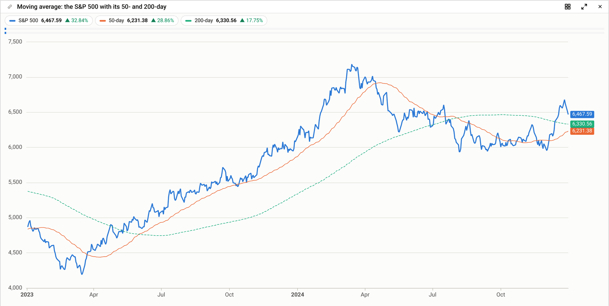

Today's tile: `mean(close[SPX], 50)` and `mean(close[SPX], 200)`, range 2Y.

What to notice: the 200-day average has a value on the first date shown. `FILTER` only hides rows, so the average was computed with the 200 days before it. Had the dates been cut from the data first, the 200-day line would start about nine months into the chart. That is why a `WHERE` in SQL's usual place is refused.

#### 2. Realized volatility at three horizons

*How volatile has the S&P 500 been over a month, a quarter and a year?*

```sql
SELECT volatility(close['SPX'], 21)  AS vol_1m,
       volatility(close['SPX'], 63)  AS vol_3m,
       volatility(close['SPX'], 252) AS vol_1y
FROM   prices ON date BY symbol
```

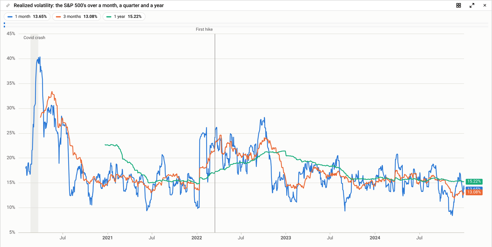

Today's tile: the same three formulas, with no quotes. The shaded band and the vertical line are notes drawn by the tile, not part of the query.

What to notice: each line starts once its window is full, so the 1-year line starts a year in. A price function's window counts returns: `volatility(x, 21)` is 21 daily returns, from 22 closes. The values are ratios (0.1365), which the tile shows as 13.65%. Writing `1mo`, `3mo` and `1y` instead gives calendar windows.

#### 3. Drawdown

*How far is Nvidia below its running peak, and what is the deepest drawdown so far?*

```sql
SELECT drawdown(close['NVDA'], all)     AS dd,
       max_drawdown(close['NVDA'], all) AS deepest
FROM   prices ON date BY symbol
```

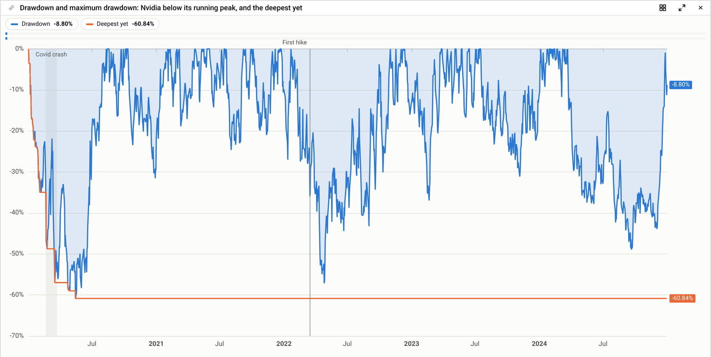

Today's tile: `drawdown(close[NVDA])` and `max_drawdown(close[NVDA])`.

What to notice: the window is always written. `all` means since the first date; `drawdown(x, 1y)` would measure against the past year's peak instead. A 60.84% fall is −0.6084.

#### 4. Weekly candles

*A candle a week for the S&P 500 over the last year.*

```sql
SELECT ohlc(first(open['SPX']), max(high['SPX']),
            min(low['SPX']),    last(close['SPX'])) AS spx
FROM   prices ON date BY symbol
SAMPLE BY 1w
FILTER date > latest - 1y
```

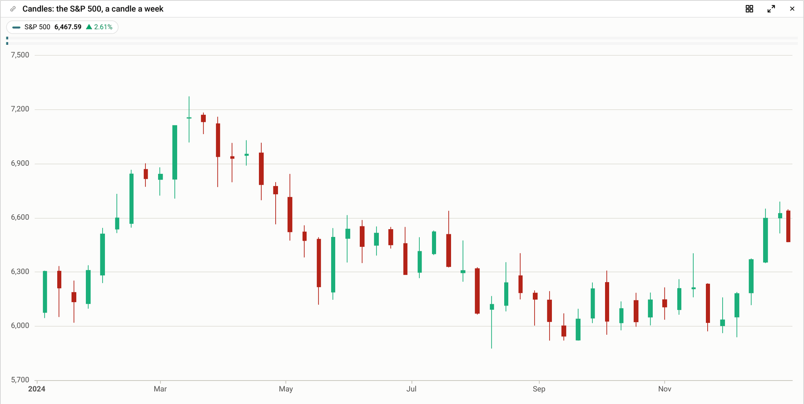

Today's tile: `ohlc(open[SPX], high[SPX], low[SPX], close[SPX])` with the frequency set to Week; the tile applies each column's weekly rule itself.

What to notice: under `SAMPLE BY` every line says how a week's rows become one value, and that is what makes a weekly candle right: the week's first open, highest high, lowest low and last close. `ohlc` returns a struct (`open`, `high`, `low`, `close`), which the tile draws as candles.

### Medium

#### 5. Rebased performance

*How have four markets done from the same start, three years ago?*

```sql
SELECT rebase(close, latest - 3y) AS perf
FROM   prices ON date BY symbol
FILTER symbol IN ('SPX', 'XOM', 'JPM', 'EURUSD')
   AND date >= latest - 3y
```

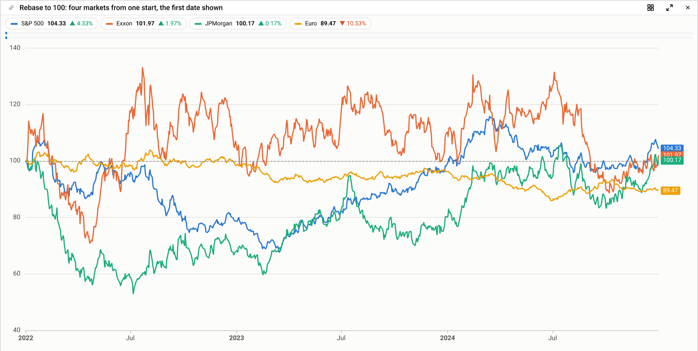

Today's tile: `rebase(close[SPX])` and three more like it, each rebased at the first date the range shows.

What to notice: plain `close` is one line per instrument, so one item gives four lines. The base date is written, and each close is taken as of it (the last close on or before). Today's tile rebases at the first date shown, and keeps doing so: it writes that date into the query for you, so existing tiles keep their numbers and the base still moves with the range. In a query, `FILTER` never changes a number, and a `rebase` with no date in a query that filters its dates gets a warning.

#### 6. A line per stock

*Each stock's 3-month volatility, one line per stock, over three years.*

```sql
SELECT volatility(close, 63) AS vol_3m
FROM   (prices WHERE asset_class = 'Equity') ON date BY symbol
FILTER date > latest - 3y
```

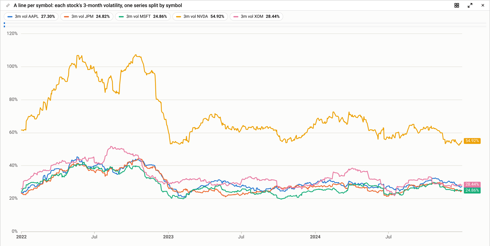

Today's tile: `volatility(close[asset_class=Equity], 63)`, split by symbol.

What to notice: here a `WHERE` on the data is right, because no figure needs another instrument's rows. If the query also divided by `close['SPX']`, the same `WHERE` would remove SPX's rows; that query is refused with the fix (keep SPX in the data, `FILTER` the answer).

#### 7. Bollinger bands

*Gold within two standard deviations of its 20-day average, over six months.*

```sql
SELECT close['GLD']                         AS gold,
       bollinger_bands(close['GLD'], 20, 2) AS bands,
       avg(close['GLD'], 20)                AS ma20,
       gold > bands.upper                   AS stretched
FROM   prices ON date BY symbol
FILTER date > latest - 6mo
```

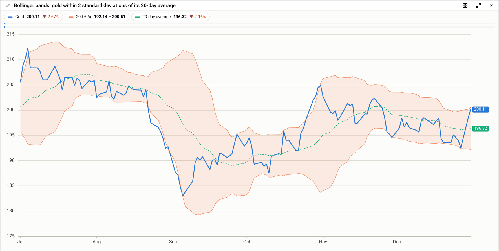

Today's tile: `close[GLD]`, `bollinger_bands(close[GLD], 20, 2)` and `mean(close[GLD], 20)`.

What to notice: `bollinger_bands` returns a struct (`lower`, `upper`, `width`), and later items read its fields by name. The deviation is the sample one (n − 1). `stretched`, not drawn here, is a true-or-false line, which the tile can shade (example 9).

#### 8. A rebalanced basket

*A 60/40 portfolio of stocks and long bonds from 100, rebalanced daily and monthly.*

```sql
SELECT basket(close['SPX'], 0.6, close['TLT'], 0.4)                         AS daily,
       basket(close['SPX'], 0.6, close['TLT'], 0.4, rebalance => 'monthly') AS monthly
FROM   prices ON date BY symbol
```

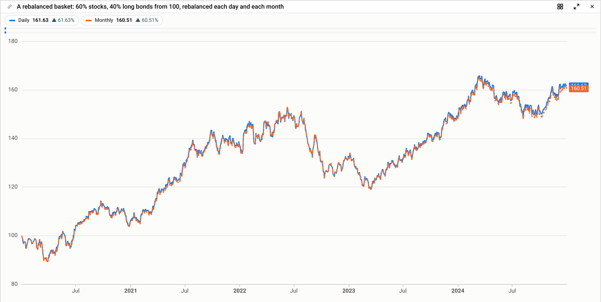

Today's tile: the same two formulas, with `rebalance=monthly` unquoted.

What to notice: an option is a string, given by name with `=>` or by place, and the first value listed is the default, so the daily basket needs no option. A basket starts at 100 and runs on the dates all its lines have.

#### 9. Shading where a condition holds, from two tables

*The S&P 500, shaded while the yield curve is inverted (the 10-year yield below the 2-year).*

```sql
SELECT px.close['SPX']                  AS spx,
       rt.yield['10Y'] - rt.yield['2Y'] AS s2s10,
       s2s10 < 0                        AS inverted
FROM   prices px ON date BY symbol,
       rates  rt ON date BY tenor
```

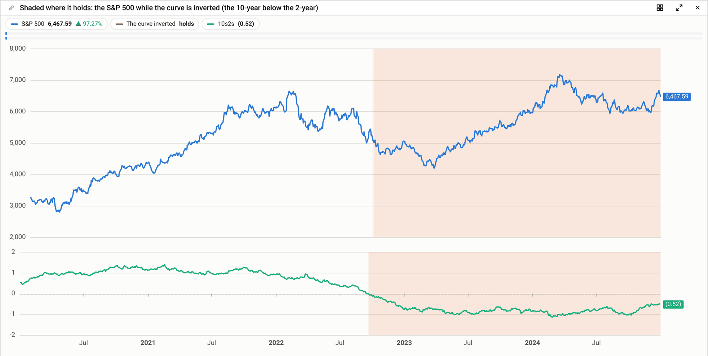

Today's tile: `px:close[SPX]`, `rates:yield[10Y] - rates:yield[2Y] < 0`, and the spread in a pane of its own.

What to notice: two tables, each with its own date and instrument columns, separated by a comma. The comma is not a join: each table's lines are picked first, and they meet on dates only where an expression combines them. The spread stays in the table's own units, percentage points here, since data is never rescaled. A true-or-false item is what the tile shades.

### Hard

#### 10. Two calendars: the S&P 500 in real terms

*The S&P 500's daily close deflated by the monthly CPI, over five years.*

```sql
SELECT px.close['SPX']                         AS spx,
       px.close['SPX'] / mc.value['CPI'] * 100 AS spx_real
FROM   prices px ON date BY symbol,
       macro  mc ON date BY series
FILL(PREV)
FILTER date > latest - 5y
```

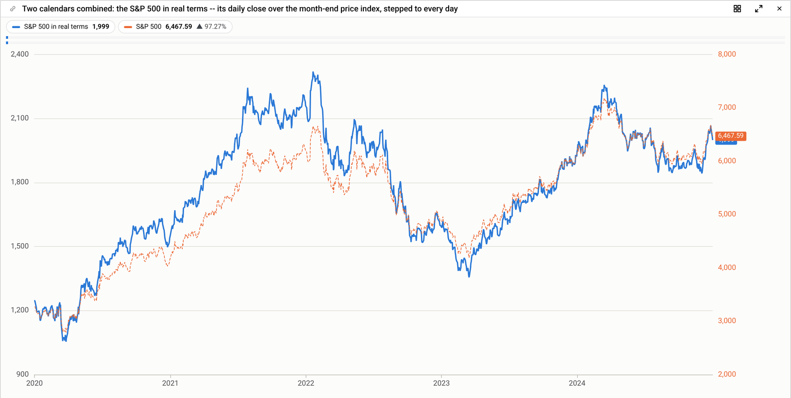

Today's tile: `px:close[SPX] / macro:value[CPI] * 100` with the alignment set to Step.

What to notice: without `FILL` the ratio would exist only on the twelve dates a year both lines have. `FILL(PREV)` gives it every trading day, CPI taking its last value. It never takes a later one, and before CPI's first value there is no ratio rather than a backfilled one.

One trap no rule can catch: `FILL` trusts the date column. If CPI is stored against the month it measures rather than the day it was published, about two weeks later, a backtest sees each print early. Store release dates, or lag it a month with `lag(mc.value['CPI'], 1)`, which is late rather than early.

#### 11. A regression, and a pairs trade

*Nvidia's 6-month alpha and R² against the S&P 500; Microsoft against Apple as a pair, its hedge ratio and spread.*

```sql
SELECT alpha(close['NVDA'], close['SPX'], 126)        AS alpha_6m,
       r_squared(close['NVDA'], close['SPX'], 126)    AS r2_6m,
       hedge_ratio(close['MSFT'], close['AAPL'], 126) AS hedge,
       residual(close['MSFT'], close['AAPL'], 126)    AS spread
FROM   prices ON date BY symbol
```

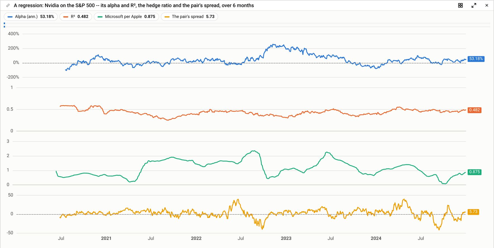

Today's tile: the same four formulas, each in its own pane.

What to notice: `alpha` and `r_squared` are of returns, computed from the prices (passing returns is refused), and `alpha` is annualized, as gs-quant's is. `hedge_ratio` and `residual` regress the price levels themselves, with an intercept: the hedge is the slope, and the spread is what the regression leaves. Every two-line function reads the dates both lines have, whatever `FILL` says.

To trade the spread takes one query more:

```sql
SELECT hedge_ratio(close['MSFT'], close['AAPL'], 126) AS hedge,
       residual(close['MSFT'], close['AAPL'], 126)    AS spread,
       zscores(spread, 63)                            AS z,
       CASE WHEN z >  2 THEN -1
            WHEN z < -2 THEN  1
            ELSE 0 END                                AS position,
       lag(position, 1) * (diff(close['MSFT'], 1)
         - lag(hedge, 1) * diff(close['AAPL'], 1))    AS daily_pnl,
       sum(daily_pnl, '2023-01-01')                   AS pnl_since_2023
FROM   prices ON date BY symbol
FILTER date >= '2023-01-01'
```

Yesterday's position, hedged with yesterday's ratio, times today's moves is the day's P&L, per share of Microsoft. The compiler reports each item's warm-up: `z` first appears about nine months in (126 trading days for the spread, then 63 for its z-score), and `daily_pnl` a day later. This is the recipe our own first draft got wrong by using today's hedge; the traps section asks whether recipes like it should be vetted functions.

#### 12. A ranking, as a table

*Each month, the three stocks with the best 12-1 momentum per unit of volatility, over the last two years.*

```sql
SELECT last(close)                              AS mo_close,
       lag(mo_close, 1) / lag(mo_close, 12) - 1 AS mom_12_1,
       volatility(mo_close, 12)                 AS vol_1y,
       mom_12_1 / vol_1y                        AS risk_adj,
       rank(risk_adj DESC)                      AS rnk
FROM   (prices WHERE asset_class = 'Equity') ON date BY symbol
SAMPLE BY 1mo
FILTER rnk <= 3 AND date > latest - 2y
```

There is no picture, because the answer is a table: a row per month for each stock kept. Python gets it as a DataFrame, and the tile shows it in its data tab.

What to notice: `rank` ranks across instruments on each date, here each month, with 1 the highest. The `WHERE` sets the universe, which changes the ranks, so it belongs with the data; `FILTER rnk <= 3` keeps the top three after ranking. `volatility(mo_close, 12)` reads 12 monthly returns and annualizes by 12 periods a year.

## Side by side with gs-quant and today's tile

Most formulas carry over almost unchanged. The differences are SQL's own meanings winning where gs-quant and SQL share a name, and quotes around instruments.

| You want | gs-quant (Python) | Today's tile formula | This language |
| --- | --- | --- | --- |
| a 50-day average | `mean(spx, 50)` | `mean(close[SPX], 50)` | `avg(close['SPX'], 50)` |
| 3-month volatility | `volatility(spx, '3m')` | `volatility(close[SPX], 3m)` | `volatility(close['SPX'], 3mo)` |
| daily log returns | `returns(spx, 1, Returns.LOGARITHMIC)` | `returns(close[SPX], 1, log)` | `returns(close['SPX'], 1, 'log')` |
| a 6-month beta | `beta(aapl, spx, '6m')` | `beta(close[AAPL], close[SPX], 6m)` | `beta(close['AAPL'], close['SPX'], 6mo)` |
| weekly closes | `bucketize(spx, AggregateFunction.LAST, AggregatePeriod.WEEK)` | the tile's frequency set to Week | `last(close['SPX'])` with `SAMPLE BY 1w` |
| a running total | `sum_(pnl)` | `sum(pnl[A])` | `sum(pnl['A'], all)` |
| the natural log | `log(x)` | `log(x)` | `ln(x)` |
| never below 0 | `floor(x, 0)` | `floor(x, 0)` | `greatest(x, 0)` |
| two series, step-aligned | `align(x, y, Interpolate.STEP)` | the tile's alignment set to Step | `FILL(PREV)` |
| shown from 2024 | slice the pandas Series | the tile's range | `FILTER date >= '2024-01-01'` |

Three differences change numbers, so they are worth knowing:

- **Units.** gs-quant's `volatility` returns 20 for 20%; here it returns 0.20.
- **No backfill.** gs-quant's step alignment fills the dates before a series starts with its first value, a value from the future. Here they stay empty.
- **Warm-up.** A 20-day average first appears on the 20th observation; gs-quant's ramp drops that one too and starts on the 21st.

The tile and Python keep accepting today's spellings and rewrite them, so existing tiles and notebooks keep working.

## Traps it is designed to stop

The worst timeseries bugs give plausible numbers and no error. Where it can, the language refuses the query and says the fix; where it cannot, it warns.

| The mistake | What it would quietly compute | What happens here |
| --- | --- | --- |
| Filtering dates before computing: a 20-day average "from January" | no values for 19 days, and January figures built from too little history | `FILTER` is the date filter, applied after; a `WHERE` in SQL's usual place is refused |
| A rolling sum of a weekly line: `sum(volume['SPX'], 4)` under `SAMPLE BY 1w` | the sum of four Fridays' volumes, about a fifth of the truth | refused: "how is volume taken each week?"; write `sum(volume['SPX']) AS wk_volume`, then `sum(wk_volume, 4)` |
| Correlating returns: `correlation(returns(x), returns(y), 60)` | the correlation of returns of returns | refused: `correlation` takes prices and computes their returns |
| Filling a series before it starts | early dates carry a value from the future | `FILL(PREV)` never fills before a line's first value |
| Leaving the benchmark out of the data: `close / close['SPX']` with only QQQ in the data | an empty ratio | refused: "SPX's rows are removed by the WHERE; to show only QQQ, FILTER the answer" |
| `200d` for a 200-day average | 200 calendar days, about 137 trading days | documented: `200` counts observations, `200d` calendar days; `m` alone is refused (minutes or months?) |
| Rebasing "since 1 January", a holiday | a base taken from an arbitrary nearby day | defined: the value as of the date, the last close on or before it, as performance is normally computed |

One kind of mistake no check catches: a valid formula that is not what a trader means. Our own first pairs-trade P&L used today's hedge ratio on today's move; the right one uses yesterday's. We would like your view on whether such recipes (pairs P&L, hedged returns, a portfolio's P&L) should be vetted functions instead of formulas everyone writes.

## Function reference, short form

The names are gs-quant's, except where SQL already uses a name differently. `w` is a window; P marks a function that takes prices or levels and computes their returns itself. The full definitions are in the specification ([TIMESERIES_LANGUAGE_2026_10_29.md](TIMESERIES_LANGUAGE_2026_10_29.md), section 6).

| Family | Functions |
| --- | --- |
| Returns and levels | `returns(x, obs, type)` P, `prices(r)`, `diff`, `lag`, `index(x, date)`, `rebase(x, date)`, `change`, `percent_change`, `annualize`, `excess_returns`, `total_return`, `geometrically_aggregate`, `basket(x, wx, y, wy, …, rebalance)`, `weighted_sum` |
| Rolling (a window `w`) | `avg` (`mean`), `sum`, `min`, `max`, `count`, `median`, `stddev` (`std`), `variance` (`var`), `range_of`, `product`, `zscores`, `percentiles`, `percentile(x, q, w)` |
| Risk | `volatility` P, `drawdown` P, `max_drawdown` P, `sharpe_ratio` P, `vol_swap_volatility` P |
| Exponential (from each line's first value) | `exponential_moving_average(x, beta)`, `exponential_std`, `exponential_volatility` P, `exponential_spread_volatility` |
| Technicals | `rsi` (0 to 100), `macd`, `smoothed_moving_average`, `bollinger_bands`, `keltner_channels`, `donchian_channels` (bands: `lower`, `upper`, `width`), `atr`, `stochastic` (0 to 100), `obv`, `vwap` |
| Two lines (of returns unless `type => 'levels'` or `'changes'`) | `correlation`, `cov`, `beta`, `r_squared`, `alpha`, `tracking_error`, `information_ratio`, `up_capture`, `down_capture`, `lead_lag` |
| Regressions of levels | `hedge_ratio(x, y, w)` (the slope), `residual(x, y, w)` (the pairs spread) |
| Mean reversion and seasonality | `dickey_fuller`, `half_life`, `trend`, `seasonally_adjusted`, `smooth_spikes`, `consecutive` |
| Combining | `if`, `CASE`, `coalesce`, `compare`, `union_of`, `append`, `prepend`, `interpolate`, `filter_values` |
| Per point | `ln`, `exp`, `sqrt`, `abs`, `power`, `greatest`, `least`, `round` |
| Within a period (`SAMPLE BY`) | `first`, `last`, `avg`, `sum`, `min`, `max`, `count`, `median` |
| A whole line | `first_of`, `last_of`, `winsorize` |
| Across instruments | `rank(x DESC)`: 1 is the first in that order, ties share a rank |
| Dates | `latest`, `value_at(x, date)`, `date_trunc`, `year`, `quarter`, `month`, `day`, `isodow` |

## Questions for you

**Continuous and discrete mode.** One reviewer asked for both. In timeseries work the phrase has at least five meanings, and each would change something different. Which did you mean?

| If you meant | Discrete | Continuous | Where the design stands |
| --- | --- | --- | --- |
| Compounding | simple returns, x / x\[-1\] − 1 | log returns, ln x − ln x\[-1\] | covered: `returns(x, 1, 'log')`, `volatility(x, w, type => 'log')` |
| What a series is between observations | values exist only at observation times | a curve defined at every instant (step or linear between points) | partly: `FILL(PREV)` and `FILL(LINEAR)` where lines meet, `value_at(x, date)` as of any date; no sampling on an arbitrary grid of times yet |
| When the query runs | once, over history | continuously, updating as new ticks arrive (streaming) | not covered: every query today runs over a snapshot; the rules (bounded windows, no look-ahead) would allow incremental updates later |
| Futures | each contract by its expiry | a continuous contract, rolled from front month to the next | not covered: needs roll rules (when to roll, back-adjusting or not) |
| The chart's time axis | trading days only, no weekend gaps | calendar time, gaps shown | a drawing setting of the tile, not of the language |

Also open:

1. **RSI and stochastic** stay on their usual 0 to 100 while every other figure is a ratio. Agree?
2. **Names that differ from gs-quant**, so SQL keeps its meanings: `ln` for `log`, `greatest`/`least` for `floor`/`ceil`, `first_of`/`last_of`, `range_of`, `union_of`, `filter_values`. Acceptable, or better names?
3. **Totals across instruments**, such as the market's total volume each day, have no function yet. What would you call it, and what else do you do across instruments besides `rank`?
4. **Vetted recipes.** Which calculations should be one trusted function rather than a formula everyone writes (pairs P&L, hedged returns, portfolio P&L)?
5. **Warm-up.** A 20-day average first appears on day 20; gs-quant starts on day 21. Which do you expect?
6. **Anything missing** from the function reference that you would reach for in your first week.

## How it has been tested, and what comes next

Nothing is built yet. To check that the rules are clear before building them, AI models were given only the specification and asked to write and read queries, graded against answers written beforehand and held back.

| Run | Spec version | Reader | Writing (30 requests) | Reading |
| --- | --- | --- | --- | --- |
| 1 | 1 | the model that wrote the spec, reading carefully | 29 right | 10 of 10 |
| 2 | 2 | a smaller, quicker model | 30 right | 13 of 13 |
| 2 | 2 | the smallest model | 30 right | 12 of 13 |

In every run, the one request not written natively was a total across instruments (question 3 above). Each run also found unclear rules, which became the next version: version 3 is the one described here. The readings included queries the rules refuse; every reader spotted them and gave the fix.

Next:

1. Your review, folded into version 4.
2. A third test run on version 4.
3. Then the build: the formula box and Python move onto the new language, and every chart in today's timeseries gallery must give the same numbers both ways before the old code is removed.
