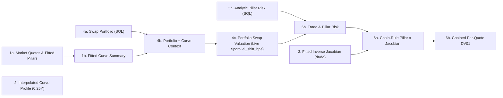

# Stage C: Interactive Notebooks, Workbench & Flow + Board Dashboards

This document covers the 5-sheet DataCube Flow + Board dashboard, CLI demo, scaling benchmark, and interactive workbench in [`pricing/demo/`](../demo/).

---

## 1. 5-Sheet Flow + Board DataCube Dashboard (`pricing/demo/dashboard.py`)

[`irs_frames()`](../demo/dashboard.py) executes **100% of curve fitting (`PureBasisCurveFitter`: 2-iteration sparse Newton-Schulz + Step-2 Halley + SQL $J^{-1}$), shared basis evaluation (`PureBasisEngine`), swap valuation, pillar risk, and par-quote DV01 chaining in DuckDB SQL**, producing 6 canonical output tables (`market_quotes`, `curve_profile`, `fitter_jacobian`, `swap_portfolio`, `pillar_risk`, `quote_risk`).

[`irs_page()`](../demo/dashboard.py) then builds a **5-sheet DataCube [`ll.Page`](../../legend_lite/page.py)** with a clean **10-box connected `page.flow()` graph** on Sheet 0 over those 6 canonical SQL tables (avoiding ~48 intermediate fitter/basis UI boxes and keeping page construction/interaction fast):



### The Five Sheets
0. **Sheet 0 — `0. Pricing & Risk Flow` (`flow = page.flow(...)`)**:
   - Clean 10-box macro compute graph wired with `page.join(...)` and `.pure(...)`, parameterized by `parallel_shift_bps` and `steepener_2s10s_bps`.
   - `4c. Portfolio Swap Valuation (Live)` applies `$parallel_shift_bps * analytic_dv01_sum` live to `sql_npv`, `5b. Trade & Pillar Risk` joins `pillar_risk` with `4c`, and `6b. Chained Par-Quote DV01` computes $\sum \text{sql\_delta} \times \partial\text{pillar}/\partial\text{quote}$ live in Flow from `5b` and `3. Fitted Inverse Jacobian`.
   - For full market quote shocks, curve recalibration, and portfolio edits, [`IRSWorkbench`](../demo/irs_workbench.py) re-runs the 100%-SQL `irs_frames()` pipeline and pushes live updates via `grid.update(...)`.
1. **Sheet 1 — `1. Market & Curve Fit`** *(reads `1a. Market Quotes & Fitted Pillars` & `2. Interpolated Curve Profile`)*:
   - **Calibration Overview**: Summary of the skinny 2-iteration SQL solver (`max |par - quote| < 1e-13`) and shared basis compression.
   - **Fitted Pillars Grid & Line Chart**: Input OIS discount and IRS 3M projection benchmark par quotes (bps), SQL-fitted zero rates (bps), zero-vs-par spread, discount factors, repriced par rates, and fit error.
   - **Interpolated Curve Profile Grid & Line Chart**: 0.25Y zero rates, 3M forward rates, and discount factors computed in SQL.
2. **Sheet 2 — `2. Products & Output Prices`** *(reads `4c. Portfolio Swap Valuation (Live)`)*:
   - **Book Summary Pivot Grid & Bar Chart**: Aggregated by `book`, `swap_type`, and `direction`, reconciling `sql_npv` vs. `python_npv` and live `bump_1bp_change` vs. `analytic_dv01_sum`.
   - **Trade-Level Valuation Grid**: Every swap's contract terms, curve bindings, SQL NPV, Python NPV, and convexity difference.
3. **Sheet 3 — `3. Output Risk Ladders`** *(reads `6b. Chained Par-Quote DV01` & `5b. Trade & Pillar Risk`)*:
   - **Par-Quote Risk Pivot Grid (with Heatmap) & Bar Chart**: Book-by-quote par-quote DV01 ladder across all 12 OIS and IRS benchmark quotes (`sql_quote_dv01` computed live in Flow).
   - **Pillar Risk Pivot Grid (with Heatmap) & Bar Chart**: Zero-rate pillar deltas ($\partial \text{NPV} / \partial r_k$) across both curves.
4. **Sheet 4 — `4. Diagnostic Curve Jacobian`** *(reads `3. Fitted Inverse Jacobian`)*:
   - **Inverse Jacobian Pivot Grid (with Heatmap) & Bar Chart**: The $12 \times 12$ SQL-inverted cross-curve Jacobian $\partial r_k / \partial q_j$, showing both intra-curve triangular coupling and cross-curve OIS-to-IRS discounting coupling.

### Binding `PureBasisMarketSession` Directly to `ll.Frames` / `ll.Page`
`PureBasisEngine` and `PureBasisMarketSession` also bind directly onto an existing `ll.Frames` or `ll.Page` for high-frequency streaming ticks (with `use_sql_fitter=True` running the skinny 2-iteration sparse Newton-Schulz + Halley SQL fitter per tick):
```python
import legend_lite as ll
from pricing.engines import PureBasisEngine

page = ll.Page('Live Desk')
with PureBasisEngine().session(portfolio, fitter, frames=page, use_sql_fitter=True) as sess:
    tick0 = sess.tick()           # 1st tick: registers static topology + session_npv & session_quote_risk
    tick1 = sess.tick(new_quotes) # warm tick: 2-step SQL curve fit + SQL valuation & risk in ~26 ms
```

---

## 2. Running the CLI Demo, Scaling Benchmark & Interactive Workbench

### A. Batch Portfolio, SQL Fitter & Multi-Dialect SQL Demo (`//python:irs_demo`)
```bash
bazel run //python:irs_demo -- --swaps 500
bazel run //python:irs_demo -- --swaps 100 --page /tmp/irs.page.json
bazel run //python:irs_demo -- --swaps 200 --sql --show
```

### B. Cold vs. Warm Market-Tick Scaling Benchmark (`//python:irs_scaling`)
```bash
bazel run //python:irs_scaling
bazel run //python:irs_scaling -- --sizes 1 10 100 1000 --ticks 5
```

### C. Interactive User Workbench (`//python:irs_workbench`)
```bash
bazel run //python:irs_workbench -- \
  --notional 25000000 --fixed-bps 365 --spread-bps 5 --start 0.5 --tenor 5 \
  --ois-bps 300 320 335 355 368 380 \
  --irs-bps 315 338 355 378 392 405

bazel run //python:irs_workbench -- --repl --show
```
