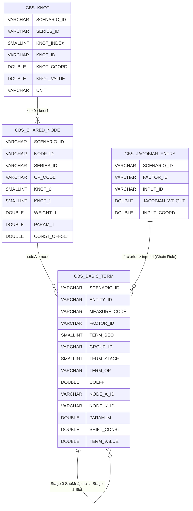

# Compute Expression DAG & Staged Piecewise Basis Compilation (`legend_lite/scalar_parallel/`)

This document details how [`legend_lite/scalar_parallel/`](../../../legend_lite/scalar_parallel/) translates traced Python math into compact pure-topology relational tables and dynamically synthesized Pure models/queries that compile to SQL across all 8 `legend-lite` database engines.

---

## 1. The Three Generic Layers

| Module | Responsibility | Key Types & Functions |
| :--- | :--- | :--- |
| **[`expr.py`](../../../legend_lite/scalar_parallel/expr.py)** | Traceable symbolic expression tree, dual numerical/symbolic math functions, Pure emitters (`to_pure`, `to_pure_diff`), cached evaluation, and exact symbolic differentiation. | `Expr`, `Const`, `Var`, `Add`, `Mul`, `Div`, `Exp`, `Log`, `Sqrt`, `Abs`, `Erf`, `exp()`, `log()`, `sqrt()`, `abs_()`, `erf()`, `evaluate()`, `diff()` |
| **[`basis.py`](../../../legend_lite/scalar_parallel/basis.py)** | Piecewise-linear interpolation (`Knot`, `PiecewiseLinear`), staged scalar `SubMeasure`, and arbitrary-degree polynomial expansion over shared basis nodes and non-linear factors. | `Knot`, `BasisNode`, `SubMeasure`, `PiecewiseLinear`, `LERP`, `EXP_NEG_XT`, `RECIP_1PXT`, `CONST`, `expand()` |
| **[`basis_pure.py`](../../../legend_lite/scalar_parallel/basis_pure.py)** | Automatic hierarchical `SubMeasure` factoring, Pure `diff()` multivariate chain-rule synthesis, dynamic `compute_basis` Pure model synthesis (`render_pure_model`), pure-topology Arrow table emission, and multi-dialect SQL planning/execution. | `BasisSchema`, `FormulaSpec`, `BasisBook`, `Scenario`, `JacobianEntry`, `ComputeBasis`, `render_pure_model()`, `measures_query()`, `chained_query()` |

---

## 2. Scalar Micro-Expressions (`expr.py`) Inside Macro `page.flow()` Blocks

### Dual Numerical / Symbolic Execution (Zero `ast.parse`, Zero `expr.lift()`)
Unlike `py-flow` (which parsed Python source code with `ast.parse`), `legend-lite` uses **zero `ast.parse`** anywhere in Python (`legend_lite/` or `pricing/`), and requires no `expr.lift()` casts or custom domain `Expr` subclasses:
- **Numerical Debug Mode (`float` in, `float` out)**: When all arguments to `expr.exp(x)`, `expr.log(x)`, `expr.sqrt(x)`, `expr.abs_(x)`, `expr.erf(x)` (or domain functions like `cnd(x)`, `black_formula(...)`) are plain Python `int`/`float` numbers (from `curve.numerical(rates)` / `surface.numerical(vols)`), they evaluate immediately via Python's `math` module and return a plain IEEE-754 `float` that can be inspected directly in `pdb` or IDE debuggers.
- **Symbolic Hash-Consed Micro-Graph (`Expr` in, `Expr` out)**: When any argument is an `Expr`, standard Python operators and math functions build a hash-consed symbolic `Expr` DAG (`Expr.__new__` interns structurally identical nodes in `_INTERN`), folding constants and `0`/`1` identities on the fly.
- **Role Inside Macro `page.flow()` Blocks**: DataCube's `page.flow()` models the **macro relational graph** (input quote tables, scenario shocks, joins, `groupBy` rollups, Board pivots), while `expr.Expr` + `BasisNode` factorizes both portfolio payoffs (`BasisBook`) and calibration par swaps (`CalibrationBasisTables`) into skinny fixed-schema relational tables (`cbs_shared_node`, `cbs_basis_term`, `cal_shared_node`, `cal_poly_slot`, `cal_jac_coords`), keeping 100-coupon schedules and symbolic derivatives compact, deduplicated, and human-debuggable.

---

## 3. Staged Piecewise Basis & Formula Expansion (`basis.py` + `basis_pure.py`)

> [!NOTE]
> **Exact Math Coordinate Basis**: The decomposition into `BasisNode` products and `SubMeasure` stages is **exact closed-form mathematics**, not an approximating Taylor or polynomial series. The terminology `Polynomial` and `expand()` comes from internal computer algebra representations used to collect and cancel common terms algebraically (e.g. $e^a e^b = e^{a+b}$). While automated approximations to a spanning basis set could be explored in future work, the current framework computes all prices and sensitivities with exact precision ($\sim 10^{-15}$).

Instead of translating nested portfolio expression trees into megabyte-scale SQL strings, `BasisBook` decomposes expressions into shared interpolation nodes (`CBS_SHARED_NODE`) and staged term rows (`CBS_BASIS_TERM`):

### Level 1 — Shared Interpolation Nodes (`CBS_SHARED_NODE`, Pure Topology)
Each `BasisNode` interpolates `x = x0 + weight1 * (x1 - x0)` between two knots of a series in `CBS_KNOT` and evaluates **once per scenario in SQL** via `compute_basis::cbsEvalNode`:
- `CONST` (`UNIT`): `constOffset`
- `LERP`: `x + constOffset`
- `EXP_NEG_XT`: `exp(-x * paramT) + constOffset`
- `RECIP_1PXT`: `1 / (1 + x * paramT) + constOffset`

`CBS_SHARED_NODE` stores **only** basis topology (`SCENARIO_ID`, `NODE_ID`, `SERIES_ID`, `OP_CODE`, `KNOT_0`, `KNOT_1`, `WEIGHT_1`, `PARAM_T`, `CONST_OFFSET`) — zero pre-evaluated float values (`TENET_CHARTER.md` C2.1).

### Level 2 — Staged Polynomials, `SubMeasure`s & Pure `diff()` Formulas (`CBS_BASIS_TERM`)
1. **Pure Polynomials (`TERM_OP` in `'CONST'`, `'LINEAR'`, `'PROD'`)**:
   - Products of `EXP_NEG_XT` nodes at the same `(series, k0, k1, weight)` automatically add their exponents (`exp(-x t1) * exp(-x t2) = exp(-x (t1 + t2))`), and division by `EXP_NEG_XT(t)` converts to multiplication by `EXP_NEG_XT(-t)`.
   - Arbitrary-degree monomials populate `NODE_A_ID .. NODE_<K>_ID` (optional slots default to `1.0`).
2. **Automatic Hierarchical `SubMeasure` Factoring (`TERM_STAGE = 0 .. max_stage`)**:
   - When `BasisBook._factor_expr` sees a multi-term additive polynomial (`len(poly) >= 2`, such as a 40-coupon swap annuity, floating leg PV, or 4-knot bilinear vol) feeding a non-polynomial operation (`Div`, `Log`, `Sqrt`, `Erf`), it factors the polynomial into a deduplicated Stage-0 `SubMeasure` (`S000000`, ...) evaluated in SQL via `cbsEvalPolyTerm` and `GROUP BY`.
3. **Compact Non-Linear Formulas & Pure `diff()` Chain Rule (`F001`, `F002`, ...)**:
   - Non-polynomial factors extract into canonical `FormulaSpec` functions (`compute_basis::cbsFormula_F001`) taking deduplicated node/sub-measure slots (`$valA ..`) and scalar parameters (`$param1 ..` from `PARAM_1 .. PARAM_<M>` on `CBS_BASIS_TERM`).
   - `BasisBook.add_pure_diff(...)` synthesizes derivative formulas calling Pure's native `diff({_dv | compute_basis::cbsFormula_F001(...)}, $valA)`, chaining through Stage-0 sub-measure derivatives via `SUB_CHAIN` (`$valChain * diff(...)`).
   - During SQL rendering, [`ProjectionCse.java`](../../../../core/src/main/java/com/legend/sql/dialect/ProjectionCse.java) automatically stages shared subexpressions and mirrored-guard `erf` arguments into inner `SqlSelect` layers (`__pc0, __pc1, ...`).

