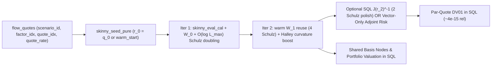

# Market Models, Volatility Surfaces & 100%-SQL Multi-Curve Calibration (`pricing/marketmodels/`)

This document explains the yield curve representation (`ZeroCurve`, `Pillar`), 2D volatility surface (`SwaptionVolSurface`), Python reference fitters (`CurveFitter`, `MultiCurveFitter`), and the **skinny relational 2-iteration 100%-SQL curve fitter, sparse Newton-Schulz solver, Halley curvature boost, and vector-only adjoint risk engine** (`PureBasisCurveFitter`) in [`pricing/marketmodels/`](../../marketmodels/).

---

## 1. Piecewise-Linear Zero Curves (`ir_curve_yield.py`)

[`ZeroCurve`](../../marketmodels/ir_curve_yield.py) represents a continuously-compounded zero-rate curve over a sorted sequence of [`Pillar(label, tenor)`](../../marketmodels/ir_curve_yield.py) knots:
- **`zero_rate(t) -> float | expr.Expr`**: Piecewise-linear `LERP` basis node over `CBS_KNOT` series `curve_id` (with flat extrapolation beyond endpoints).
- **`df(t) -> float | expr.Expr`**: Discount factor $\exp(-t \cdot r(t))$ (`EXP_NEG_XT` basis node; `1.0` for $t \le 0$).
- **`fwd(start, end) -> float | expr.Expr`**: Simply-compounded forward rate $\frac{D(t_1) / D(t_2) - 1}{t_2 - t_1}$.
- **`numerical(rates) -> ZeroCurve`**: Plain-`float` twin so instrument pricing and par-rate methods can be stepped through with plain IEEE-754 numbers in a debugger (zero DuckDB/JVM dependency).

---

## 2. 2D Bilinear Swaption Volatility Surface (`swaption_vol_surface.py`)

[`SwaptionVolSurface`](../../marketmodels/swaption_vol_surface.py) models implied Black-76 volatilities $\sigma(T_{\text{exp}}, T_{\text{swap}})$ over an `expiries` $\times$ `swap_tenors` knot grid:
- **`vol(expiry, swap_tenor) -> float | expr.Expr`**: Bilinear interpolation across the 4 surrounding `(expiry_i, tenor_j)` surface knots, automatically factored into a reusable Stage-0 `SubMeasure` when feeding `black_formula`.
- **`factors() -> list[FactorSpec]`**: Exposes every `(expiry, tenor)` knot as a differentiable factor so `FirstOrderAnalyticRisk` computes exact bucketed 2D Surface Vega in SQL alongside curve deltas.
- **`numerical(vols=None)`**: Plain-`float` twin for numerical debugging and finite-difference Vega checks.

---

## 3. Skinny Relational 2-Iteration 100%-SQL Curve Fitter (`ir_curve_fitter.py`)

Why do 2 iterations suffice for swap curve calibration, and how does `PureBasisCurveFitter` scale to 200+ coupled parameters inside SQL without column bloat?

1. **Quadratic Newton Convergence from Par-Rate or Warm Seeding (`DEFAULT_NEWTON_STEPS = 2`)**:
   - Seeding pillar zero rates at the input market par quotes ($\mathbf{r}^{(0)} = \mathbf{q}$, or from a cached prior curve via `initial_rates` / `warm_start=True`) starts within $\sim 5\text{ bps}$ ($5 \times 10^{-4}$) of the solution.
   - Because swap par rates $p_i(\mathbf{r})$ are smooth, mildly nonlinear functions of $\mathbf{r}$, 2 symbolic Newton/Halley updates converge to machine precision (`9.71e-16` at $N=200$).
   - **Small-$N$ scalar helpers preserved**: `seed_curve_state_pure`, `newton_step_pure`, and `inverse_jacobian_pure` remain available as small-$N$ wide-column inspection helpers, while `PureBasisCurveFitter` uses the skinny relational solver below.

2. **Skinny Relational Calibration Basis (`build_calibration_basis_tables`)**:
   - **Why wide-column SQL fails at scale**: Wide-column SQL (`r_0..r_{N-1}`, `w_{i}_{m}`) generates $O(N^2)$ projection columns, causing DuckDB planner OOM ($\sim 28\text{ GB}$) at $N \ge 100$.
   - **Fixed-width schema independent of $N$**: `build_calibration_basis_tables` factors every par-rate numerator $F_i(\mathbf{r})$, annuity $A_i(\mathbf{r})$, and active partial derivative $\partial F_i / \partial r_k$, $\partial A_i / \partial r_k$ into three scenario-independent, fixed-width Arrow tables:
     - `cal_shared_node` (7 cols: `node_id, op_code, k0, k1, weight_1, param_t, const_offset`)
     - `cal_poly_slot` (8 cols: `quote_idx, role, col_k, term_seq, term_degree, coeff, slot_idx, node_id`)
     - `cal_jac_coords` (2 cols: `row_i, col_j` over transitive reachability of active Jacobian dependencies)
   - **Zero per-instance Pure compile cost**: All 11 skinny Pure-to-SQL kernels (`skinny_*_pure`) compile **once per SQL dialect** (`_SKINNY_KERNEL_CACHE`), so new `PureBasisCurveFitter` instances have `0 ms` Pure compiler overhead (`~55 ms` table setup even at $N = 200$).

3. **Sparse Newton-Schulz Pointer-Doubling & Overlapping Dependencies (`skinny_init_w0_pure`, `skinny_schulz_step_pure`)**:
   - Handles overlapping multi-curve dependencies (e.g., 2-curve IRS depending on both OIS discount knots and 3M projection knots, interpolated intermediate coupons, and non-triangular coupled instruments) without sequential $N$-stage SQL back-substitution.
   - **Step 1**: Initializes the 1st-order Neumann preconditioner $W_0 = (I + L) D^{-1}$ and iterates sparse pointer-doubling $W_{\text{next}} = W(2I - J W)$ over `cal_jac_coords`:
     - Lower-triangular / DAG dependencies with max path length $L_{\max}$: exact finite termination ($L^{L_{\max}+1} = 0$) in $\max(0, \lceil \log_2 \max(2, L_{\max}+1) \rceil - 1)$ stages (`2` stages at $N=12$, `6` stages at $N=200$).
     - Cyclic / non-triangular coupled pillars: `7` quadratic-convergence stages.
   - **Step $\ge 2$ & Final $J^{-1}$ Warm Inverse Reuse**: Step 2 seeds directly from $W_1 \approx J(\mathbf{r}^{(0)})^{-1}$ and runs `4` quadratic-refinement stages ($\|I - J_1 W_1\|^{2^4} < 10^{-16}$); optional explicit $J(\mathbf{r}^{(2)})^{-1}$ runs `2` polish stages from $W_2$. Intermediate tables materialize inside DuckDB (`_host.statements`) with zero intermediate Python/Arrow roundtrips.
   - **Dashboard Separation (`irs_frames()` vs `irs_page()`)**: `PureBasisCurveFitter` executes all skinny 2-iteration calibration, $J^{-1}$, and basis evaluation steps directly inside DuckDB SQL (`irs_frames()` / `PureBasisMarketSession`). `irs_page()` then renders a fast 10-box connected `page.flow()` graph over the 6 canonical output tables (live `$parallel_shift_bps` valuation + live `pillar_risk` $\times$ `fitter_jacobian` chain-rule DV01), avoiding ~48 intermediate fitter/basis UI boxes.

4. **Step-2 Componentwise Halley Curvature Boost (`halley=True`, `skinny_halley_update_pure`)**:
   - Exploits the non-linearity already learned between Step 1 ($W_0, \mathbf{s}^{(1)}$) and Step 2 ($W_1, \mathbf{s}^{(2)}_N = W_1 \mathbf{f}(\mathbf{r}^{(1)})$) with **zero** extra derivative or residual evaluations:
     $$\alpha_i = \operatorname{clip}\!\left(\frac{s^{(1)}_i \, s^{(2)}_{N,i}}{(s^{(1)}_i)^2 + 10^{-24}}, -0.25, 0.25\right), \qquad s^{(2)}_i = s^{(2)}_{N,i} + \frac{1}{2}\,\alpha_i \bigl(s^{(2)}_{N,i} - (W_0 \mathbf{f}(\mathbf{r}^{(1)}))_i\bigr)$$
   - Componentwise $\alpha_i$ avoids diluting long-end convexity (`25Y`) with near-linear short-end pillars (`0.25Y`).

5. **Vector-Only Adjoint Quote Risk (`fit_and_adjoint_risk_sql`, `skinny_adjoint_risk_pure`)**:
   - Computes book par-quote DV01s $\boldsymbol{\lambda} = (J(\mathbf{r}^{(2)})^{-1})^T \boldsymbol{\delta}$ using skinny matrix-vector joins seeded from $W_1^T$ (`(2 W_1^T - W_1^T J_2^T W_1^T) delta` plus 2 iterative adjoint refinement passes $\boldsymbol{\lambda} \leftarrow \boldsymbol{\lambda} + W_1^T(\boldsymbol{\delta} - J_2^T \boldsymbol{\lambda})$), achieving `~4e-15` relative precision without ever forming $W_2 = J(\mathbf{r}^{(2)})^{-1}$.

6. **Verified Scaling Benchmarks ($N = 200$ Coupled OIS + 3M Pillars, 0.25Y–25Y, 3,900 Jacobian Non-Zeros)**:

   | Workload ($N = 200$ coupled parameters) | Wide-Column SQL | Skinny SQL (`PureBasisCurveFitter`) | Accuracy vs Converged Python |
   | :--- | :--- | :--- | :--- |
   | Schema width & Pure compile | $O(N^2)$ cols; 28 GB DuckDB OOM | Constant (2–8 cols); `0 ms` cached (`55 ms` table init) | Exact schema parity across all $N$ |
   | Cold 2-step SQL fit (`compute_jacobian=False`) | OOM | **`104.4 ms`** | `max |dr| = 9.71e-16` vs 2-step Python |
   | Warm-tick SQL fit (`warm_start=True`) | OOM | **`71.1 ms`** | `< 1e-15` |
   | 2-step SQL fit + full $200 \times 200$ SQL $J^{-1}$ | OOM | **`127.5 ms`** | `max |d(J^-1)| = 1.17e-12` ($\kappa(J) \sim 10^3$) |
   | 2-step SQL fit + 2-book Adjoint Quote Risk (`fit_and_adjoint_risk_sql`) | OOM | **`123.1 ms`** (no $W_2$ matrix formed) | `1.99e-10` \$ on \$35M swaps (`~4e-15` rel) |
   | $+200\text{ bp}$ stress shock (2 steps, `halley=True` vs `False`) | OOM | Same 2 steps, zero extra derivs | Up to **`12.2x`** lower error (from flat seed; `2.1x` from pre-shock curve, `< 3e-8`) |

- **Standalone Python Reference Path Preserved**: `CurveFitter.fit(steps=None)` and `MultiCurveFitter.fit(steps=None)` remain 100% pure Python (zero DuckDB/Arrow dependency) for step-debugging and differential verification against `fitter.sql_fitter()`.
