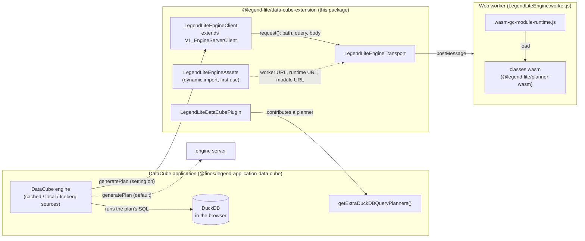

# @legend-lite/data-cube-extension

A plugin for Legend DataCube that adds legend-lite as a planner for **cached sources, local files and cached Iceberg
tables**. For those sources DataCube asks for an execution plan only to take the SQL out of it, and runs that SQL on its
own DuckDB. With this plugin registered, legend-lite's engine module (`@legend-lite/planner-wasm`, built from
`//wasm:engine_planner`) can generate that plan in the browser, in a worker, instead of the engine server.

This directory is the plugin's source and this file is the guide to building, publishing and registering it in a
DataCube deployment. It is written so that someone, or a Claude session, with none of the history can do the work
from here. **The package is not built or tested by this repository's Bazel build** (it depends on legend-studio's
`@finos` packages, which this repository does not carry). The checks it went through are listed in
[What was verified](#what-was-verified).

## Contents

- [How it fits together](#how-it-fits-together)
- [What it needs from legend-studio](#what-it-needs-from-legend-studio)
- [The files](#the-files)
- [Implementing it in a deployment, step by step](#implementing-it-in-a-deployment-step-by-step)
  - [1. Build the engine module package](#1-build-the-engine-module-package)
  - [2. Publish the engine module package](#2-publish-the-engine-module-package)
  - [3. Build and publish this package](#3-build-and-publish-this-package)
  - [4. Register the plugin](#4-register-the-plugin)
  - [5. Bundling and serving](#5-bundling-and-serving)
  - [6. Turn it on and watch it](#6-turn-it-on-and-watch-it)
- [Trying it locally against public legend-studio](#trying-it-locally-against-public-legend-studio)
- [Tests](#tests)
- [Known gaps and temporary code](#known-gaps-and-temporary-code)
- [What was verified](#what-was-verified)
- [A brief for a Claude session](#a-brief-for-a-claude-session)

## How it fits together



- **The hook.** `LegendDataCubeApplicationPlugin.getExtraDuckDBQueryPlanners()` lets a plugin contribute a planner: a
  key, a label, a factory for an engine server client, and a rule for which queries it is asked for. Each contributed
  planner adds one setting, off by default, that **uses** it instead of the engine server. With no plugin registered
  nothing changes, and public legend-studio
  registers none.
- **The client.** `LegendLiteEngineClient` is a `V1_EngineServerClient` whose `request()` asks the engine module
  instead of the network. Every method keeps its name, input, output and errors. A route legend-lite does not answer
  fails as a server would, with a `NetworkClientError` carrying the status. Nothing falls back to the engine server.
- **The transport.** It starts the worker on the first request, matches answers to requests by id, and unfolds the
  module's answer format: `OK\n<status>\n<content type>\n<body>` or `ERR\n<kind>\n<message>`.
- **The worker** loads the runtime by URL (it must not be bundled) and the module once, then answers
  `pureV1OrError(path, query, body)` for each request.
- **Laziness.** Registering the plugin fetches nothing of the module (about 9.3 MB, 3.5 MB gzipped). DataCube creates
  the client when a setting is on and a query is planned with it. The client loads `LegendLiteEngineAssets.js` by a
  dynamic `import()`, and only that file refers to the module's files.

## What it needs from legend-studio

The hook is not in a released `@finos/legend-application-data-cube` yet. It is proposed in
[MauricioUyaguari/legend-studio#2](https://github.com/MauricioUyaguari/legend-studio/pull/2), which adds:

| Export of `@finos/legend-application-data-cube` | What it is |
|---|---|
| `LegendDataCubeApplicationPlugin` | The DataCube plugin base class (not exported before) |
| `getExtraDuckDBQueryPlanners?(): LegendDataCubeDuckDBQueryPlanner[]` | The hook, on that class |
| `LegendDataCubeDuckDBQueryPlanner` | `{ key, label, createEngineServerClient(), isQuerySupported?(query) }` |
| `LegendDataCubeQueryPlannerClient` | `V1_EngineServerClient & { dispose?: () => void }` |

**The first released version with the hook is not known yet.** Once it is released, set it as the lower bound of the
`@finos/legend-application-data-cube` peer dependency in `package.json` (now `*`). Until then, build against a local
legend-studio checkout of that branch; see [Trying it locally](#trying-it-locally-against-public-legend-studio).

## The files

| File | What it does |
|---|---|
| `src/index.ts` | The package's exports. It deliberately does not export `LegendLiteEngineAssets.js` |
| `src/LegendLiteDataCubePlugin.ts` | The plugin: contributes the planner (key and label `legend-lite`) and creates its client on first use |
| `src/LegendLiteEngineClient.ts` | `V1_EngineServerClient` answered by the module: overrides `request()`, and adjusts the model for G1/G2 |
| `src/LegendLiteEngineTransport.ts` | The worker port, request ids, the answer format, `LegendLiteEngineError` for failures of legend-lite itself |
| `src/LegendLiteEngine.worker.ts` | The worker. Self-contained: it imports nothing at run time, and is served as its own file |
| `src/LegendLiteEngineAssets.ts` | The only file that names the module's files: the worker URL, the runtime URL, the `.wasm` URL |
| `src/LegendLiteQuerySupport.ts` | Which queries legend-lite is asked for: all but a pivot with no cast (G3) |
| `src/wasm.d.ts` | Types a `.wasm` import as its URL |
| `src/__tests__/*.test.ts` | Unit tests (43): the client, the transport, the query rule, the plugin |
| `package.json`, `tsconfig*.json` | The package. Compiler settings are legend-studio's (`@finos/legend-dev-utils/tsconfig.base.json`) |

## Implementing it in a deployment, step by step

The commands assume a private npm registry configured for the `@legend-lite` scope. If your registry requires another
scope or name, change the `name` of both packages and the imports that name `@legend-lite/planner-wasm`
(`src/LegendLiteEngineAssets.ts`, and the dependency in `package.json`).

### 1. Build the engine module package

In a legend-lite checkout:

```bash
bazel build //wasm:engine_planner_package
```

The package is the directory `bazel-bin/wasm/engine_planner_package`: `classes.wasm`, `wasm-gc-module-runtime.js`,
`index.d.ts`, `package.json`, `README.md`, `LICENSE`, `NOTICE`, `THIRD_PARTY_NOTICES.md`. The test
`//wasm:engine_planner_package_test` checks that every file `package.json` names is there and that the module, loaded
through the package entry, answers a route.

### 2. Publish the engine module package

`wasm/npm/package.json` is `"private": true` so that nothing publishes it by accident. A publish job must:

1. Copy `bazel-bin/wasm/engine_planner_package` out of Bazel's output tree (it is read-only).
2. Remove `"private": true` and set `"version"` (one version per legend-lite commit published, e.g. `0.1.0-<sha>`).
3. `npm publish` to the private registry. Do not publish it to the public npm registry.

```bash
cp -R bazel-bin/wasm/engine_planner_package /tmp/planner-wasm && chmod -R u+w /tmp/planner-wasm
cd /tmp/planner-wasm
npm pkg delete private && npm pkg set version=0.1.0-$(git -C "$OLDPWD" rev-parse --short HEAD)
npm publish --registry <your registry>
```

`npm pack --dry-run` on the package lists 8 files, 3.5 MB packed, 9.4 MB unpacked. (The commands above were not run
against a registry; they are what a publish job does.)

### 3. Build and publish this package

1. Copy this directory (`wasm/data-cube-extension`) to where the package is built.
2. Set `dependencies["@legend-lite/planner-wasm"]` to the version published in step 2.
3. Add the build's dev dependencies, at the versions of the legend-studio release you target: `typescript`,
   `@finos/legend-application-data-cube`, `@finos/legend-data-cube`, `@finos/legend-graph`, `@finos/legend-shared`
   (and `@jest/globals` for the tests).
4. `npm run build` compiles `src` to `lib` (`tsconfig.build.json` leaves the tests out).
5. Remove `"private": true`, set the version, and `npm publish` to the private registry.

The built `lib/LegendLiteEngine.worker.js` must still import nothing (`grep -n '^import' lib/LegendLiteEngine.worker.js`
prints nothing); and `lib/LegendLiteDataCubePlugin.js` must load `./LegendLiteEngineAssets.js` by `import()` only.

### 4. Register the plugin

In the deployment that starts DataCube, add `@legend-lite/data-cube-extension` as a dependency and add the plugin to
the plugins it registers. In legend-studio that is `getPluginCollection()` in
`packages/legend-application-data-cube-bootstrap/src/index.tsx`:

```ts
import { LegendDataCube } from '@finos/legend-application-data-cube';
import { LegendLiteDataCubePlugin } from '@legend-lite/data-cube-extension';

export class LegendDataCubeWebApplication {
  static getPluginCollection(): AbstractPlugin[] {
    return [
      // loggers
      new WebConsole(),
      // legend-lite as a planner for cached sources, local files and cached Iceberg tables
      new LegendLiteDataCubePlugin(),
    ];
  }

  static run(baseUrl: string): void {
    LegendDataCube.create()
      .setup({ baseAddress: baseUrl })
      .withPresets(LegendDataCubeWebApplication.getPresetCollection())
      .withPlugins(LegendDataCubeWebApplication.getPluginCollection())
      .start();
  }
}
```

Nothing else is configured: the plugin adds its setting to DataCube's settings, under the debug group, off.

### 5. Bundling and serving

The assets file uses three patterns a bundler must handle. legend-studio's webpack configuration
(`@finos/legend-dev-utils/WebpackConfigUtils.js`) handles all three as is:

| In `LegendLiteEngineAssets.js` | What the bundler must do |
|---|---|
| `import engineModule from '@legend-lite/planner-wasm/classes.wasm'` | Emit the file and give its URL. legend-studio's rule: `test: /\.(?:…\|wasm)$/, type: 'asset/resource'` |
| `new URL('./LegendLiteEngine.worker.js', import.meta.url)` | Emit the worker file as is (webpack 5 does, for `new URL(…, import.meta.url)`) |
| `new URL('@legend-lite/planner-wasm/wasm-gc-module-runtime.js', import.meta.url)` | Emit the runtime file as is. It must not be bundled |

Each URL is created on its own line on purpose: written as `new Worker(new URL(…))`, webpack would bundle the
worker's script instead of emitting the file.

What the server and the page must allow:

- **`.wasm` served as `application/wasm`.** The runtime compiles with `WebAssembly.compileStreaming`, which refuses
  any other content type.
- **Same origin.** The worker, the runtime and the module are loaded from the application's own origin; a module worker
  must be same-origin.
- **Content security policy**, if the page sets one: `worker-src 'self'`, `script-src 'self'` (the worker imports the
  runtime), and `'wasm-unsafe-eval'` in `script-src` to compile WebAssembly.
- **WebAssembly GC.** The module needs a browser with WebAssembly GC and exception handling. It was run in Chrome only;
  see [What was verified](#what-was-verified).

### 6. Turn it on

The setting is in DataCube's **Settings** (application menu, top right), in the debug group:

| Setting | Key | Effect |
|---|---|---|
| Planner: Use legend-lite for Cached and Local Sources (Experimental) | `debugger.planner.legend-lite.enabled` | legend-lite plans every query it supports, in the tab. A query it does not support (G3) still goes to the engine server. A failure shows `[legend-lite] <message>`, and is not retried on the engine server |

The first query planned with legend-lite loads the module (about 3.5 MB gzipped) and starts the worker; later queries
reuse it. With legend-lite in use, the browser's network panel shows no `generatePlan` request to the engine server.

There is no compare mode in this first step (decided 2026-11-23): nothing runs the engine's plan beside legend-lite's.
Grammar and typing calls still go to the engine server either way.

## Trying it locally against public legend-studio

This is how the package was checked: public legend-studio with the hook's branch, the two packages copied into
`node_modules` as an install from a registry would put them, and two local-only edits.

```bash
# legend-lite: build the engine module package
bazel build //wasm:engine_planner_package

# legend-studio, on the branch with the hook (MauricioUyaguari/legend-studio#2):
# its usual setup, which builds every package's lib
cd legend-studio && yarn install && yarn build
mkdir -p node_modules/@legend-lite
cp -R <legend-lite>/bazel-bin/wasm/engine_planner_package node_modules/@legend-lite/planner-wasm
chmod -R u+w node_modules/@legend-lite/planner-wasm
cp -R <legend-lite>/wasm/data-cube-extension node_modules/@legend-lite/data-cube-extension
(cd node_modules/@legend-lite/data-cube-extension && ../../.bin/tsc -p tsconfig.build.json)

# once: writes packages/legend-application-data-cube-deployment/dev/config.json (it replaces the dev folder)
yarn workspace @finos/legend-application-data-cube-deployment setup
```

The two packages are not declared dependencies, so **any later `yarn install` removes the copies** from `node_modules`;
repeat the copy after one.

Then, without committing either:

1. Register the plugin in `packages/legend-application-data-cube-bootstrap/src/index.tsx` as in
   [step 4](#4-register-the-plugin), and run `yarn workspace @finos/legend-application-data-cube-bootstrap build:ts`.
2. Point `packages/legend-application-data-cube-deployment/dev/config.json` at an engine server (its `engine.url`).

```bash
cd packages/legend-application-data-cube-deployment
NODE_ENV=development yarn webpack serve --mode development --host localhost --port 9007
```

Open `http://localhost:9007/datacube`, create a DataCube from a local CSV file (New DataCube, source type Local File),
and turn the setting on. It can also be set before the page loads:

```js
const k = 'legend-data-cube';
const v = JSON.parse(localStorage.getItem(k) || '{}');
v['application-settings-storage'] = v['application-settings-storage'] || {};
v['application-settings-storage']['data-cube'] = {
  'debugger.planner.legend-lite.enabled': true,
};
localStorage.setItem(k, JSON.stringify(v));
```

With it on, the network panel shows no `generatePlan` request to the engine server, and shows the assets chunk and
`LegendLiteEngine.worker.js` loaded on the first query and not before.

Note: on legend-studio `master` the dev app crashes on start when `dev/config.json` has no `oidcConfig` (it reads
`auth.user` of an undefined `auth` in `LegendDataCubeWebApplication.tsx`). That is unrelated to this package. Either
configure sign-in, or locally change that line to
`(auth as typeof auth | undefined)?.user?.access_token ? auth.settings : undefined`.

## Tests

The tests are written for legend-studio's jest setup: jsdom, `@jest/globals`, `@finos/legend-shared/test`,
`@finos/legend-graph/test`. Two things an outside package must supply:

- **A stub for DataCube's DuckDB engine.** Importing `@finos/legend-application-data-cube` loads the whole application,
  whose DuckDB engine uses `import.meta`, which jest cannot parse. legend-studio's own tests mock that module. Here,
  stub it in the jest configuration, for example:

  ```js
  // jest.config.js
  moduleNameMapper: {
    'LegendDataCubeDuckDBEngine(\\.js)?$': '<rootDir>/test/LegendDataCubeDuckDBEngineStub.js',
  },
  ```

  ```js
  // test/LegendDataCubeDuckDBEngineStub.js
  export class LegendDataCubeDuckDBEngine {
    async initialize() {}
    async dispose() {}
  }
  ```

  Only `LegendLiteDataCubePlugin.test.ts` needs it. When the tests were run, a `jest.mock` of that module's resolved
  path did the same; this `moduleNameMapper` form was not itself run.
- **`Response`.** jsdom has none. The client tests install a small stand-in (`TEST__Response`) in `beforeAll`.

## Known gaps and temporary code

Each of these is marked `TEMPORARY` in the code, with the condition for removing it.

| Gap | Where | What happens | Remove when |
|---|---|---|---|
| G1: a relational connection without `postProcessorWithParameter` is refused (legend-studio's serializer leaves the empty array out) | legend-lite's `ConnectionReader.java`; shimmed by `liftEmbeddedConnections` in `LegendLiteEngineClient.ts` | The client adds what is missing before `generatePlan` | legend-lite accepts the connection as sent |
| G2: `generatePlan` refuses a connection embedded in the runtime, which is how DataCube sends it | legend-lite's `edge/PureV1Routes.java`; shimmed by the same function | The client moves each embedded connection into an element of its own | legend-lite plans over an embedded connection |
| G3: a pivot with no cast plans as two statements (DataCube runs this query, with `limit 0`, to find a pivot's columns) | `LegendLiteQuerySupport.ts` | That query goes to the engine server in every mode | legend-lite plans it as one statement for DuckDB |
| G4: the `last()` aggregate fails | legend-lite | The query fails with legend-lite's message | Fixed in legend-lite |
| G5: arithmetic on a nullable column fails to compile | legend-lite's `Typer.java` | As G4 | Fixed in legend-lite, once legend-engine's answer is checked |
| G11: DuckDB versions differ (legend-studio pins `@duckdb/duckdb-wasm` 1.31.0; legend-lite is tested on DuckDB 1.5.x), and legend-lite's SQL assumes a UTC session, which DataCube does not set | Both | A result that may differ from the engine's, e.g. on dates | Settled between the two projects |

There is also no timeout on a request to the worker: a module that never answers leaves its query waiting.

## What was verified

Verified, on 2026-11-20, and again on 2026-11-23 after compare mode was taken out of the hook:

- The package compiled (`tsc`, tests included) inside a legend-studio checkout's `node_modules`, against the public
  indexes of `@finos/legend-application-data-cube` (with the hook), `@finos/legend-data-cube`, `@finos/legend-graph`
  and `@finos/legend-shared`. legend-studio's DataCube bootstrap compiled against its typings.
- Its 43 tests passed under legend-studio's jest configuration (with the DuckDB engine mocked; see [Tests](#tests)).
- The DataCube dev app (webpack 5, development mode), with the plugin registered and a 60-row local CSV, in Chrome:
  - At start, nothing of legend-lite was fetched. The assets chunk and the worker were loaded on the first query.
  - The setting was shown, named `legend-lite`.
  - With it on, no `generatePlan` request reached the engine server, and the grid showed all 60 rows.
  - (On 2026-11-20, with the compare mode the hook then had, legend-lite's result also matched the engine's.)

Not verified:

- A production build (`yarn bundle`) of a deployment with the plugin, and serving it behind a real server and CSP.
- Firefox and Safari.
- A cached source, and a cached Iceberg table (only a local file was run).
- The packages installed from a registry (they were copied into `node_modules`); the publish commands of steps 2 and
  3 were not run; nor was the `moduleNameMapper` stub.
- Two behaviours that moved between packages in this shape, run in the app before the move but not after it, and
  covered by no test of DataCube's engine:
  - a query legend-lite fails on shows its message prefixed with `[legend-lite]` exactly once;
  - with use on, the query that discovers a horizontal pivot's columns still goes to the engine server
    (`isQuerySupported`), and the pivot itself to legend-lite.
- This repository's `//gates:local`.

## A brief for a Claude session

Paste this, with the placeholders filled in, into a Claude session opened in the repository that deploys DataCube:

> Add legend-lite as a planner for Legend DataCube's cached sources, local files and cached Iceberg tables. The plugin
> source and the full guide are in the legend-lite repository at `wasm/data-cube-extension/` (read its `README.md`
> first, then every file under `src/`). The engine module package is built by `bazel build
> //wasm:engine_planner_package` in legend-lite.
>
> 1. Publish `@legend-lite/planner-wasm` (from `bazel-bin/wasm/engine_planner_package`) and
>    `@legend-lite/data-cube-extension` to `<registry>`, following the README's steps 2 and 3. Package scope:
>    `<scope>`.
> 2. Our DataCube deployment is `<package>`. Add `@legend-lite/data-cube-extension` as its dependency and register
>    `new LegendLiteDataCubePlugin()` in its plugin collection (README step 4). It needs
>    `@finos/legend-application-data-cube` `<version with getExtraDuckDBQueryPlanners>`.
> 3. Check the bundler and server against README step 5: `.wasm` as `application/wasm`, same origin, and the CSP.
> 4. Add the tests from `src/__tests__/` to our jest setup, with the DuckDB engine stub from the README's Tests
>    section, and run them.
> 5. Run the app locally, turn on "Planner: Use legend-lite for Cached and Local Sources", open a local CSV file, and
>    show me that the grid is drawn and that no `generatePlan` request reached the engine server.
>
> Do not change the plugin's behaviour: no fallback from legend-lite to the engine server, and nothing of the module
> loaded before a setting is on. Tell me what you could not verify.
